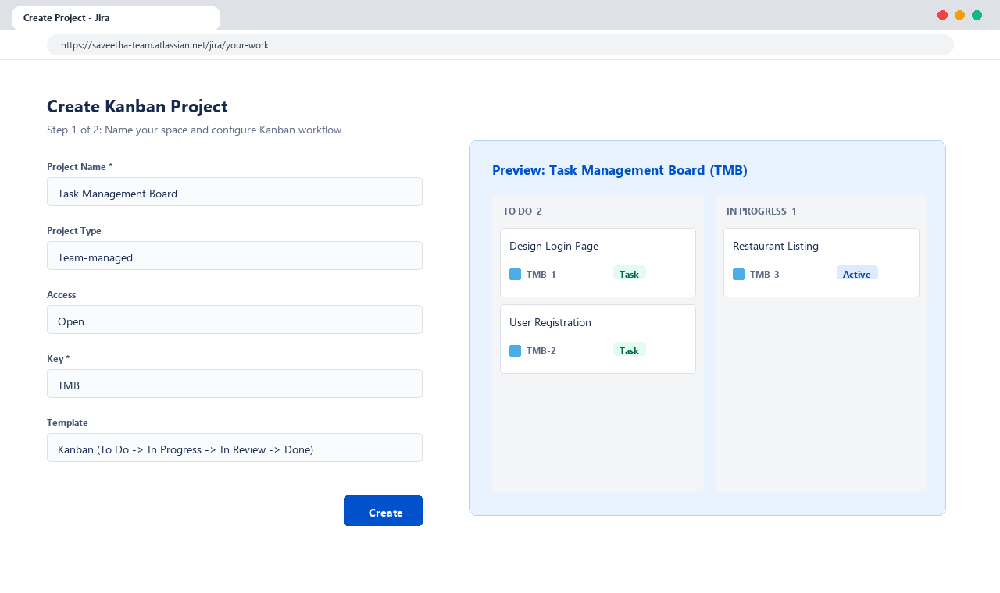
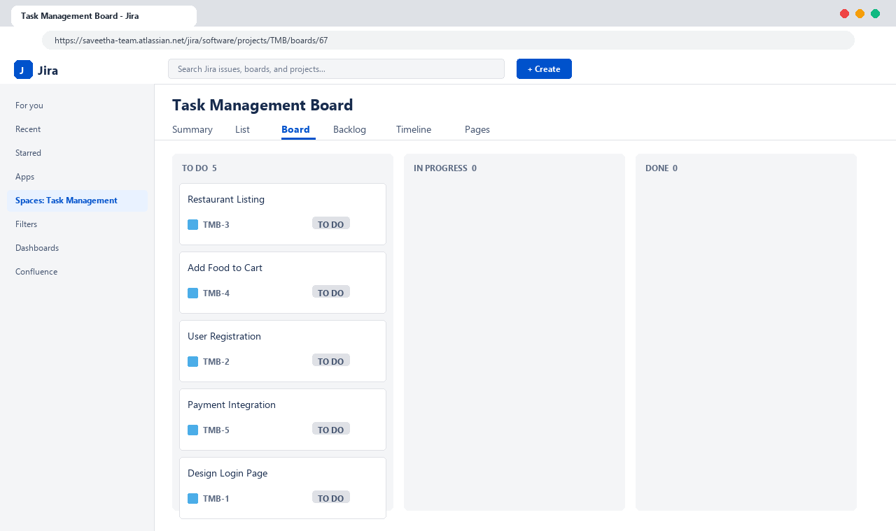
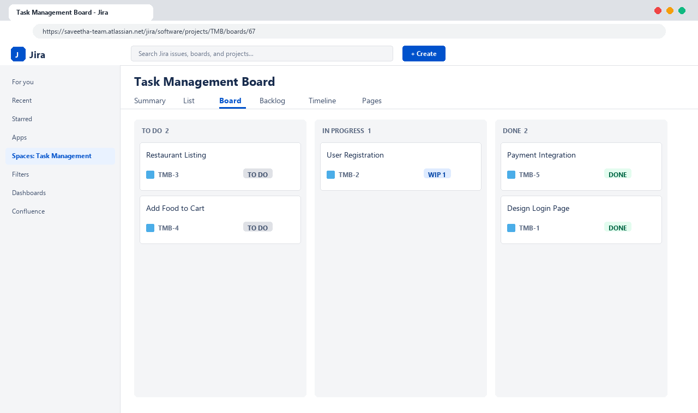

# Experiment 01: Kanban Board for Task Visualization using Jira

| Attribute | Details |
| :--- | :--- |
| **Experiment No.** | 01 |
| **Tools Used** | Jira Software (Cloud) or Trello |
| **Course Outcome** | CO1 |

---

## Problem Statement
Create a Kanban Board to visualize the tasks:
1. Create columns for **To Do**, **In Progress**, and **Done**.
2. Add at least **5 sample tasks**.
3. Move the tasks across the columns to simulate the workflow.

## Aim
To create a Kanban board in Jira with To Do, In Progress, and Done columns, add at least five sample tasks, and move the tasks across the columns to simulate the workflow of a project.

## Software / Tools Required
- Jira Software (Cloud) – Free Plan, or Trello
- Web Browser (Google Chrome / Microsoft Edge)
- Atlassian Account

## Theory
Kanban is a lean, visual method for managing work. Work items are written on cards and placed on a board divided into columns, each representing one workflow stage. Team members pull a card into the next column only when they have capacity:
- **Visualize the workflow:** Every task is visible as a card on the board.
- **Limit Work In Progress (WIP):** Only a fixed number of cards may sit in the In Progress column, preventing multitasking and exposing bottlenecks.
- **Manage flow:** Cards move continuously from left to right.
- **Continuous improvement:** Cycle time and lead time are measured and refined.

Unlike Scrum, Kanban has no fixed-length sprints; work flows continuously.

## Procedure
1. **Login to Jira:** Navigate to `https://id.atlassian.com/login` and sign in with your Atlassian credentials.
2. **Create the Kanban Project:** Click **Create Project**, choose the **Kanban** template, set project name to `Task Management Board`, key `TMB`, type **Team-managed**, access **Open**, and click **Next**.
3. **Configure Project Settings:** Verify Work Types (`Epic`, `Feature`, `Task`, `Story`, `Bug`), Statuses (`To Do`, `In Progress`, `In Review`, `Done`), and Views. Disable *Start with sample work items* and finish creation.
4. **Add Tasks to Backlog & Board:** Create the sample tasks (`TMB-1` Design Login Page, `TMB-2` User Registration, `TMB-3` Restaurant Listing, `TMB-4` Add Food to Cart, `TMB-5` Payment Integration, plus backlog items `Collect Project Requirements`, `Design UI Mockups`).
5. **Initial Board State:** Verify all five active tasks appear under the **TO DO** column.
6. **Move Issues Across Workflow:**
   - Drag `User Registration (TMB-2)` from **To Do** → **In Progress**.
   - Drag `Design Login Page (TMB-1)` from **To Do** → **In Review** → **Done**.
   - Drag `Payment Integration (TMB-5)` from **To Do** → **Done**.
   - Leave `Restaurant Listing (TMB-3)` and `Add Food to Cart (TMB-4)` in **To Do**.
7. **Verify Final Workflow Simulation:** Confirm the board clearly reflects pending, active, and completed tasks.

## Task Configuration Artifact
See [`kanban-tasks.json`](./kanban-tasks.json) for the structured task dataset used in this simulation.

## Output Screenshots

### 1. Create Kanban Project & Configure Settings

### 2. Backlog & Initial To Do Board (5 Tasks)

### 3. Workflow Simulation (To Do → In Progress → Done)

## Expected Output
- A Jira Kanban project named **Task Management Board** is created.
- Five or more tasks are created in the **To Do** column.
- Tasks are moved across **To Do → In Progress → In Review → Done**, and the final board displays tasks in every stage.

## Result
Thus the Kanban board was created in Jira, sample tasks were added and moved across the To Do, In Progress, and Done columns, and the project workflow was simulated successfully.

## Viva Voce Questions
1. **What is Kanban?**  
   A visual workflow-management method using a board, columns, and cards to show work status and limit work in progress.
2. **What is a WIP limit?**  
   The maximum number of work items allowed in a column at one time; it prevents multitasking and exposes bottlenecks.
3. **How does Kanban differ from Scrum?**  
   Kanban has continuous flow without sprints or fixed roles; Scrum uses time-boxed sprints, sprint planning, and defined roles.
4. **What is lead time and cycle time?**  
   Lead time is from request to delivery; cycle time is from start of work to completion.
5. **Name two reports available on a Jira Kanban board.**  
   Cumulative Flow Diagram and Control Chart.
