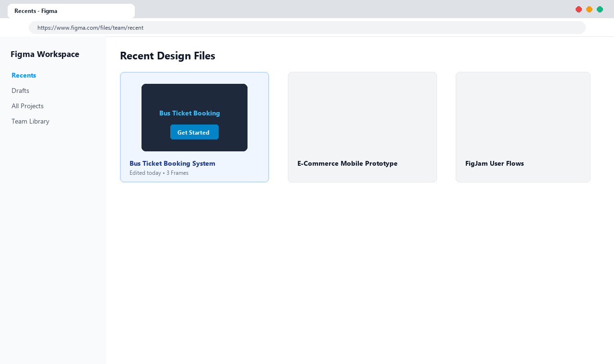
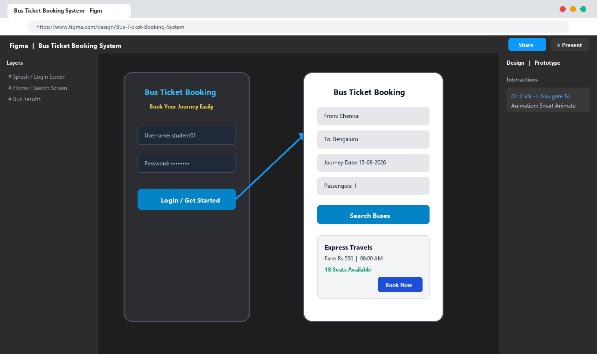
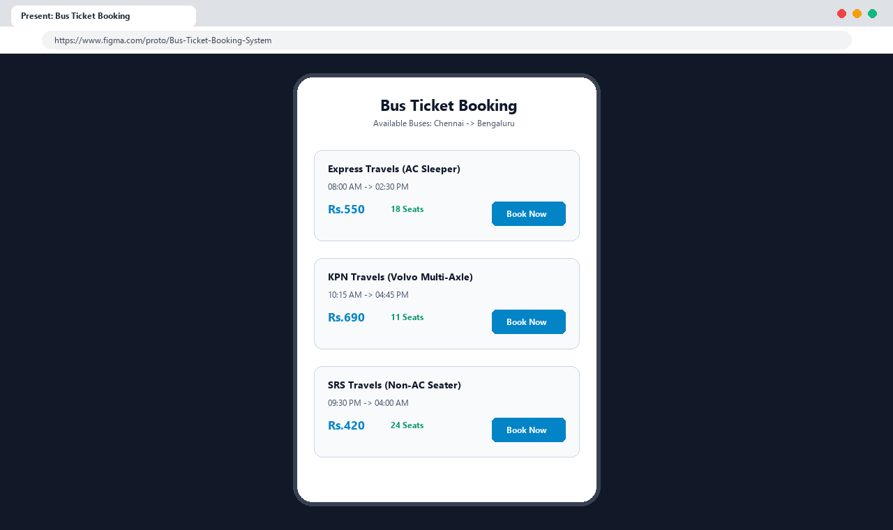

# Experiment 02: Prototype of a Bus Ticket Booking System using Figma

| Attribute | Details |
| :--- | :--- |
| **Experiment No.** | 02 |
| **Tools Used** | Figma |
| **Course Outcome** | CO1 |

---

## Problem Statement
Sketch a simple prototype of a **Bus Ticket Booking System** using the Figma tool.

## Aim
To sketch and build a simple clickable prototype of a Bus Ticket Booking System (Splash/Login screen and Home/Search screen) using Figma.

## Software / Tools Required
- Figma (Web or Desktop App) – Free Account
- Web Browser

## Theory
A prototype is an early, simplified model of a software product built to collect user feedback before development:
- **Low-fidelity prototype:** Rough sketches or wireframes showing layout.
- **High-fidelity prototype:** Screens close to the final product with colours, imagery, and click-through interactions.
- **Throw-away vs Evolutionary prototyping:** Throw-away prototypes are discarded after validation; evolutionary prototypes are iteratively refined into the final system.

In Figma, screens are built inside **Frames** and connected in **Prototype** mode using interactions (`On Click → Navigate to`).

## Procedure
1. **Login to Figma:** Open `https://www.figma.com`, sign in, and click **New Design File**.
2. **Create Frames:** Select the Frame tool (`F`) and create frames for the Splash/Login Screen and Home/Search Screen.
3. **Design Login / Splash Screen:** Add title **Bus Ticket Booking**, tagline *Book Your Journey Easily*, Username/Password fields, and a **Login / Get Started** button.
4. **Design Home / Search Screen:** Add fields for **From**, **To**, **Journey Date**, **Passengers**, a **Search Buses** button, and sample bus listing (`Express Travels – ₹550 – 08:00 AM – Book Now`).
5. **Connect Screens:** Switch to the **Prototype** tab and link `Login / Get Started` → `Home Screen`.
6. **Preview Prototype:** Click **Present (▶)** and test the booking flow.

## Interactive HTML Prototype Companion
An interactive browser-previewable version of this prototype is included in [`prototype/index.html`](./prototype/index.html).

## Output Screenshots

### 1. Figma Dashboard & Design File

### 2. Splash / Login & Home Search Frames

### 3. Search Buses & Ticket Selection Preview

## Expected Output
- Frames for Login/Splash and Home/Bus Search screens.
- Navigation interaction configured in Prototype mode and verified in Present mode.

## Result
Thus a simple clickable prototype of the Bus Ticket Booking System was designed in Figma and the navigation flow was tested successfully.

## Viva Voce Questions
1. **What is a prototype?** An early working model of a system used to understand and validate requirements.
2. **What is a Frame in Figma?** A fixed-size artboard container (mobile or desktop) holding UI elements.
3. **How are two screens linked in Figma?** In Prototype mode, drag the connection node from an element to the target frame (`On Click → Navigate To`).
4. **Which SDLC model uses prototyping?** The Prototyping model and iterative/evolutionary models.
5. **Difference between wireframe and mock-up?** A wireframe is a low-fidelity layout; a mock-up is a high-fidelity static visual design.
