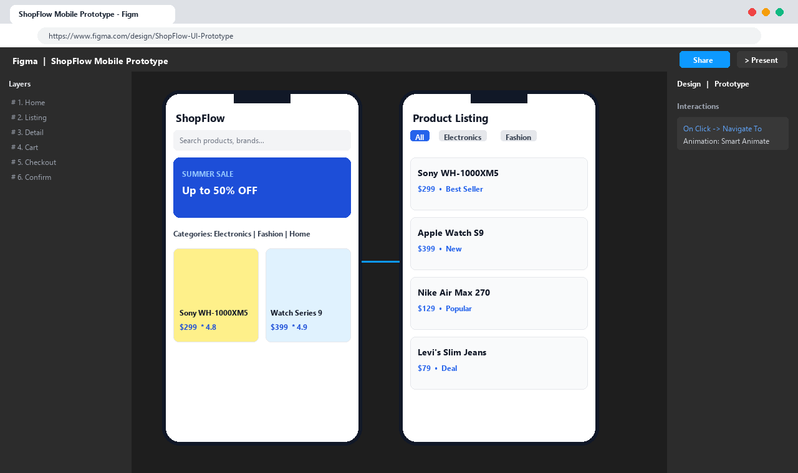
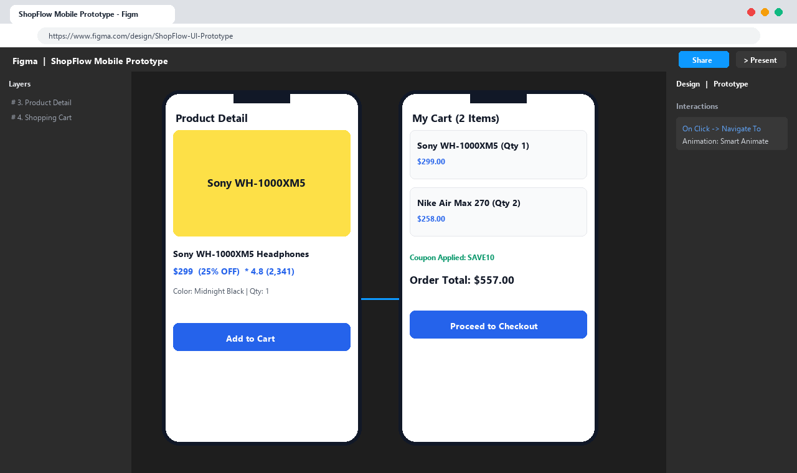
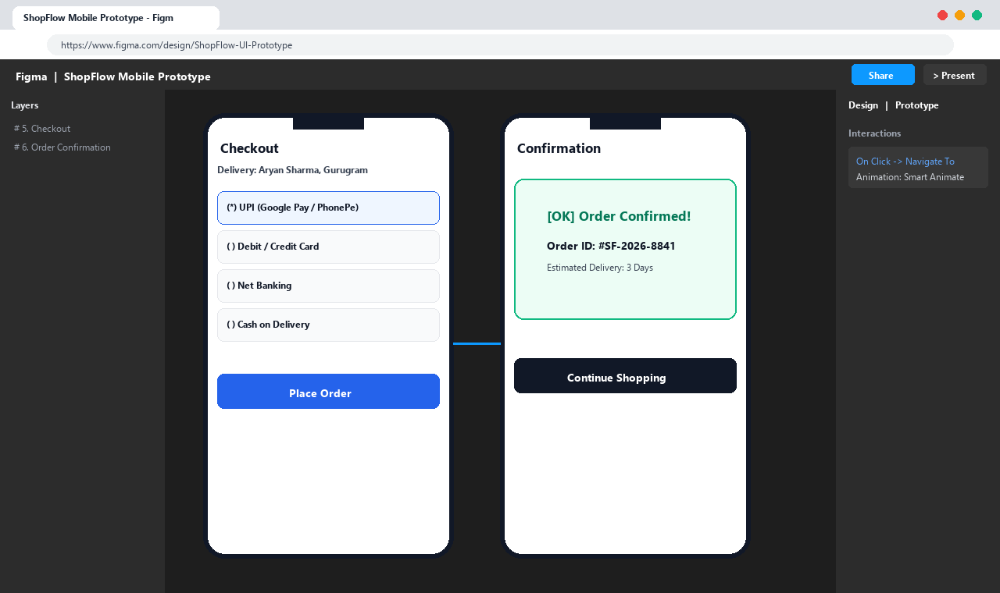

# Experiment 03: E-Commerce Mobile App Prototype using Figma for Stakeholder Feedback

| Attribute | Details |
| :--- | :--- |
| **Experiment No.** | 03 |
| **Tools Used** | Figma |
| **Course Outcome** | CO1 |

---

## Problem Statement
The stakeholders have conflicting views on the user interface design for an E-Commerce mobile app. Create a prototype using Figma to discuss with the stakeholders to get their feedback and approval.

## Aim
To design an interactive prototype of an E-Commerce mobile application (**ShopFlow**) using Figma so stakeholders can review the user interface flow and provide feedback.

## Software / Tools Required
- Figma – Free Account
- Web Browser
- Figma Mirror (optional)

## Theory
When stakeholders disagree on UI design, an interactive prototype provides a shared, concrete artefact for review:
- **Components & Auto Layout:** Maintain consistent cards, buttons, and spacing.
- **Click-through Journey:** `Home → Product Listing → Product Detail → Shopping Cart → Checkout → Order Confirmation`.
- **Comments & Iteration:** Stakeholders leave pinned comments directly on frames, enabling fast revision and approval.

## Procedure
1. **Login & Setup:** Open Figma and create a new design file.
2. **Create Mobile Frames:** Select **iPhone 14 (390 × 844)** frames for six screens.
3. **Home Screen:** Logo (`ShopFlow`), search bar, promo banner (`Up to 50% OFF`), categories, featured products.
4. **Product Listing & Product Detail Screens:** Category filter pills, product cards with ratings, colour selector, quantity stepper, and **Add to Cart**.
5. **Shopping Cart Screen:** Line items, coupon input (`SAVE10`), order summary, and **Proceed to Checkout**.
6. **Checkout & Order Confirmation Screens:** Delivery address, payment method (UPI / Card / Net Banking / COD), **Place Order**, and Order ID confirmation.
7. **Link & Review:** Connect all screens in **Prototype** mode, share the Present link with stakeholders, collect comments, and refine.

## Interactive HTML Prototype Companion
See [`prototype/index.html`](./prototype/index.html) for a clickable 6-screen flow.

## Output Screenshots

### 1. Home Screen & Product Listing

### 2. Product Details & Shopping Cart

### 3. Checkout & Order Confirmation

## Expected Output
- Mobile frames for Home, Listing, Details, Cart, Checkout, and Confirmation screens.
- Screens linked in Prototype mode and reviewed with stakeholder feedback.

## Result
Thus an interactive prototype of the E-Commerce mobile application was created in Figma and shared with stakeholders to collect feedback on the user interface.

## Viva Voce Questions
1. **Why is prototyping useful when stakeholders disagree?** It offers a visual, testable model so decisions are grounded in concrete screens rather than assumptions.
2. **What is Auto Layout in Figma?** A layout feature that arranges child elements with automatic spacing and resizing.
3. **What is a component in Figma?** A reusable design element whose main edits propagate to all instances.
4. **How do you share a Figma prototype?** Click Share, configure view/comment permissions, and send the prototype link.
5. **Name two usability principles applied.** Layout consistency and clear call-to-action navigation.
