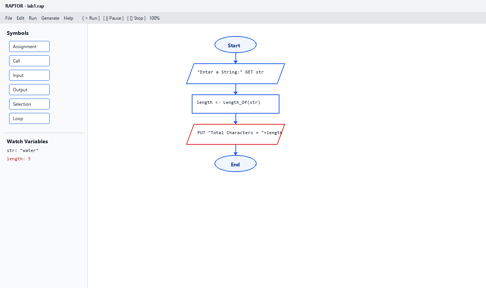
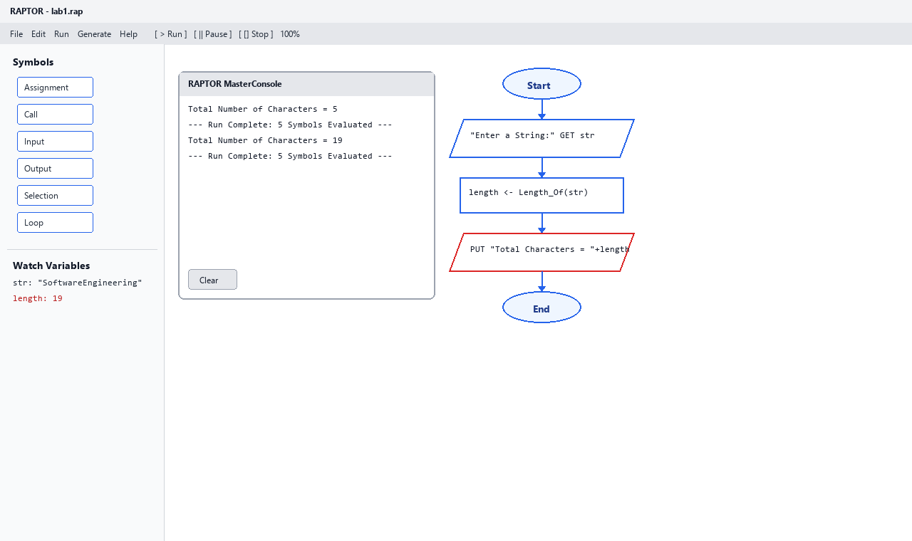

# Experiment 04: Flowchart to Find the Length of a String using RAPTOR

| Attribute | Details |
| :--- | :--- |
| **Experiment No.** | 04 |
| **Tools Used** | RAPTOR |
| **Course Outcome** | CO1 |

---

## Problem Statement
Using RAPTOR, draw a flowchart to read a string, compute the total number of characters in the string, and display the result.

## Aim
To draw and execute a flowchart in RAPTOR that reads a string from the user, calculates the total number of characters, and displays it.

## Software / Tools Required
- RAPTOR (Rapid Algorithmic Prototyping Tool for Ordered Reasoning)
- Windows PC

## Theory
A string is an immutable sequence of characters enclosed in double quotes. RAPTOR allows designing and executing flowcharts visually using standard symbols (`Input`, `Assignment`, `Output`, `Selection`, `Loop`, `Call`). The built-in function `Length_Of(str)` returns the character count of `str`.

**Algorithm:**
1. Start
2. Read `str`
3. `length ← Length_Of(str)`
4. Display `"Total Number of Characters =" + length`
5. Stop

## Procedure
1. Launch RAPTOR and select **File → New**.
2. Drag an **Input** symbol between `Start` and `End`; prompt `"Enter a String:"` and store into `str`.
3. Drag an **Assignment** symbol below Input and set `length ← Length_Of(str)`.
4. Drag an **Output** symbol below Assignment and output `"Total Number of Characters = " + length`.
5. Click **Run (Execute to Completion)** and test with `"water"` (5) and `"SoftwareEngineering"` (19).

## Flowchart & Runnable Equivalent
- Mermaid Flowchart: [`flowchart.mmd`](./flowchart.mmd)
- Python Equivalent: [`string_length.py`](./string_length.py)

## Output Screenshots

### 1. RAPTOR Flowchart Design

### 2. RAPTOR MasterConsole Execution Output

## Expected Output
- Input: `SoftwareEngineering` → Output: `Total Number of Characters = 19`

## Result
Thus the flowchart to find the length of a given string was drawn, executed, and verified using RAPTOR.

## Viva Voce Questions
1. **What is RAPTOR?** A flowchart-based visual programming tool used to design and run algorithms.
2. **Which function returns string length in RAPTOR?** `Length_Of()`.
3. **What does immutable string mean?** Its contents cannot be modified after creation; edits produce a new string.
4. **Name the six basic RAPTOR symbols.** Assignment, Call, Input, Output, Selection, and Loop.
5. **How is the flowchart executed?** Via Run (Execute to Completion) or step-by-step execution.
