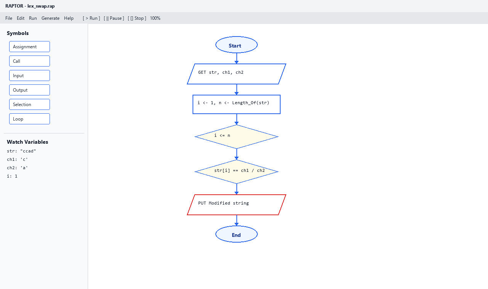
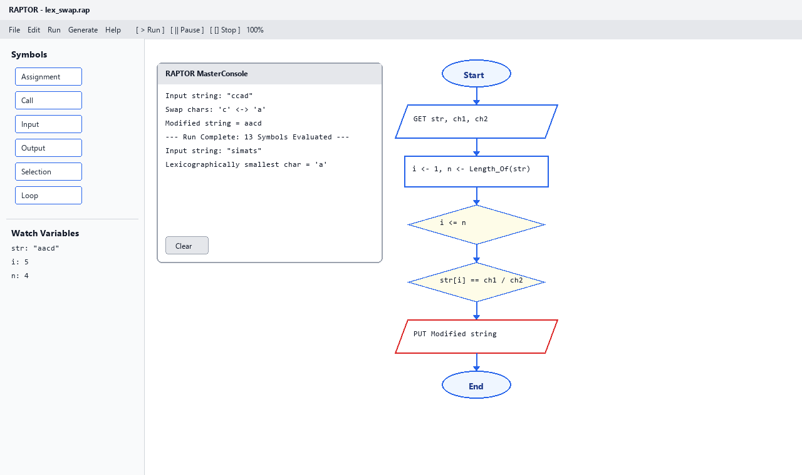

# Experiment 05: Lexicographically Smallest String by Swapping Two Characters using RAPTOR

| Attribute | Details |
| :--- | :--- |
| **Experiment No.** | 05 |
| **Tools Used** | RAPTOR |
| **Course Outcome** | CO1 |

---

## Problem Statement
Given a string of lowercase English alphabets, choose any two characters and replace all occurrences of the first character with the second and all occurrences of the second with the first at most once. Using RAPTOR, draw and validate a flowchart to find the lexicographically smallest string obtainable.

## Aim
To draw and validate a RAPTOR flowchart that swaps all occurrences of two chosen characters at most once to produce the lexicographically smallest string.

## Software / Tools Required
- RAPTOR
- Windows PC

## Theory
String $A$ is lexicographically smaller than $B$ if at the first differing position $A$ has the smaller character. To obtain the smallest string with at most one global character-pair swap:
1. Scan left-to-right for the first character `ch1 = str[i]` that has a strictly smaller character appearing later in the string (`ch2`).
2. Traverse the string (`i ← 1` to `Length_Of(str)`): replace every `ch1` with `ch2` and every `ch2` with `ch1`.
- Example: `str = "ccad"` → swap `'c'` and `'a'` → `"aacd"`.

## Procedure
1. Open RAPTOR (**File → New**).
2. Add **Input** symbols to read `str`, `ch1`, and `ch2` (or automatically find the optimal `(ch1, ch2)` pair).
3. Initialize `i ← 1`, `n ← Length_Of(str)`.
4. Add a **Loop** running while `i <= n`.
5. Inside the loop, use **Selection** symbols: if `str[i] = ch1` set `str[i] ← ch2`; else if `str[i] = ch2` set `str[i] ← ch1`.
6. Increment `i ← i + 1`.
7. After the loop, output the modified string and validate with sample inputs (`ccad` → `aacd`, `simats` → smallest char `'a'`).

## Flowchart & Runnable Equivalent
- Mermaid Flowchart: [`flowchart.mmd`](./flowchart.mmd)
- Python Implementation: [`lex_smallest_swap.py`](./lex_smallest_swap.py)

## Output Screenshots

### 1. RAPTOR Input & Flowchart Logic

### 2. RAPTOR MasterConsole Validation Output

## Expected Output
- Input: `str = "ccad"`, `ch1 = 'c'`, `ch2 = 'a'` → Output: `Modified string = aacd`

## Result
Thus the flowchart to obtain the lexicographically smallest string by swapping all occurrences of two characters at most once was drawn and validated using RAPTOR.

## Viva Voce Questions
1. **What is lexicographic order?** Dictionary order—strings are compared character by character from left to right.
2. **Why is the operation done at most once?** Only one pair of characters may have all their occurrences swapped.
3. **How is the i-th character accessed in RAPTOR?** Using `str[i]` with 1-based indexing.
4. **What is the time complexity of the replacement scan?** $O(n)$.
5. **Which RAPTOR symbol represents if-else?** The Selection symbol.
