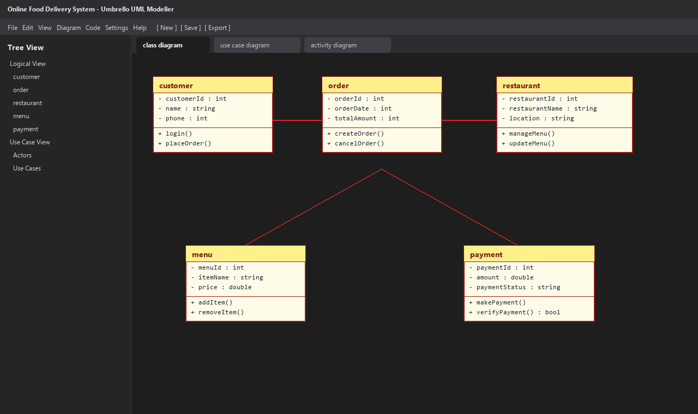
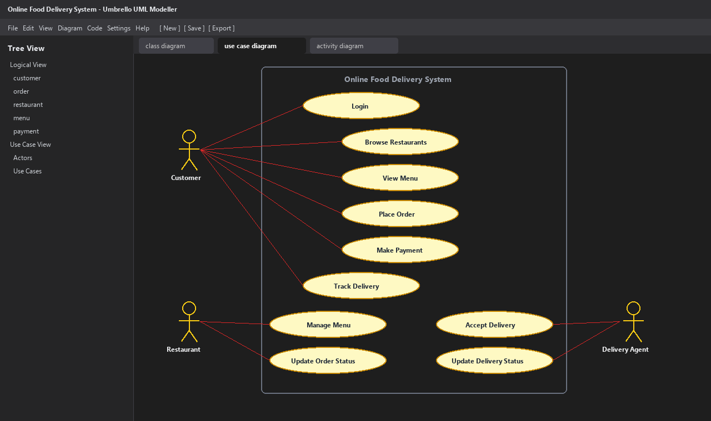
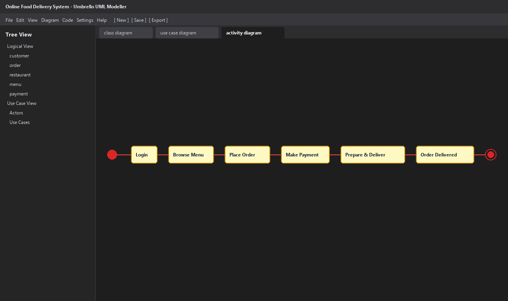

# Experiment 06: UML Class, Use Case and Activity Diagrams for an Online Food Delivery System

| Attribute | Details |
| :--- | :--- |
| **Experiment No.** | 06 |
| **Tools Used** | Umbrello UML Modeller |
| **Course Outcome** | CO1 |

---

## Problem Statement
An online food delivery platform enables customers to browse restaurants, view menus, place food orders, make online payments, and track delivery status. Restaurants manage menus and update order status, while delivery agents accept requests and update delivery progress. Design a **Class Diagram**, **Use Case Diagram**, and **Activity Diagram**.

## Aim
To design the Class diagram, Use Case diagram, and Activity diagram for an Online Food Delivery System showing relevant classes, attributes, methods, actors, and workflow.

## Software / Tools Required
- Umbrello UML Modeller / StarUML
- Windows / Linux PC

## Theory
UML provides complementary structural and behavioural views:
- **Class Diagram (Structural):** Models `Customer`, `Restaurant`, `Menu`, `Order`, and `Payment` with attributes, operations, and associations/aggregations.
- **Use Case Diagram (Functional):** Models actors (`Customer`, `Restaurant`, `Delivery Agent`) and use cases (`Browse Restaurants`, `View Menu`, `Place Order`, `Make Payment`, `Track Delivery`, `Manage Menu`, `Accept Delivery`).
- **Activity Diagram (Dynamic):** Models end-to-end flow from Login → Browse → Place Order → Make Payment → Prepare & Deliver → Order Delivered.

## Procedure
1. Launch Umbrello UML Modeller and create project `Online Food Delivery System`.
2. Create **Class Diagram** with classes `Customer`, `Order`, `Restaurant`, `Menu`, and `Payment`, complete with attributes, visibility, and methods.
3. Create **Use Case Diagram** with actors `Customer`, `Restaurant`, `Delivery Agent` linked to their use cases.
4. Create **Activity Diagram** from Initial Node through actions and decision nodes to Final Node.
5. Verify relationships, multiplicities, and export diagrams.

## Diagram Sources
- Class Diagram: [`diagrams/class_diagram.mmd`](./diagrams/class_diagram.mmd)
- Use Case & Activity Flow: [`diagrams/activity_diagram.mmd`](./diagrams/activity_diagram.mmd)

## Output Screenshots

### 1. Class Diagram – Online Food Delivery System

### 2. Use Case Diagram – Online Food Delivery System

### 3. Activity Diagram – Online Food Delivery System

## Expected Output
- Class, Use Case, and Activity diagrams representing all actors, entities, and workflow stages.

## Result
Thus the Class, Use Case, and Activity diagrams for the Online Food Delivery System were designed using the UML tool and verified successfully.

## Viva Voce Questions
1. **What is UML?** Unified Modelling Language—a standard graphical notation for software modeling.
2. **Differentiate aggregation and composition.** Aggregation is a weak whole-part link; composition is strong ownership where parts die with the whole.
3. **What is an actor?** A role played by a user or external system interacting with the system.
4. **Difference between `<<include>>` and `<<extend>>`?** `<<include>>` is mandatory reuse; `<<extend>>` is optional conditional behaviour.
5. **What is a fork node?** A bar that splits one flow into concurrent parallel flows.
