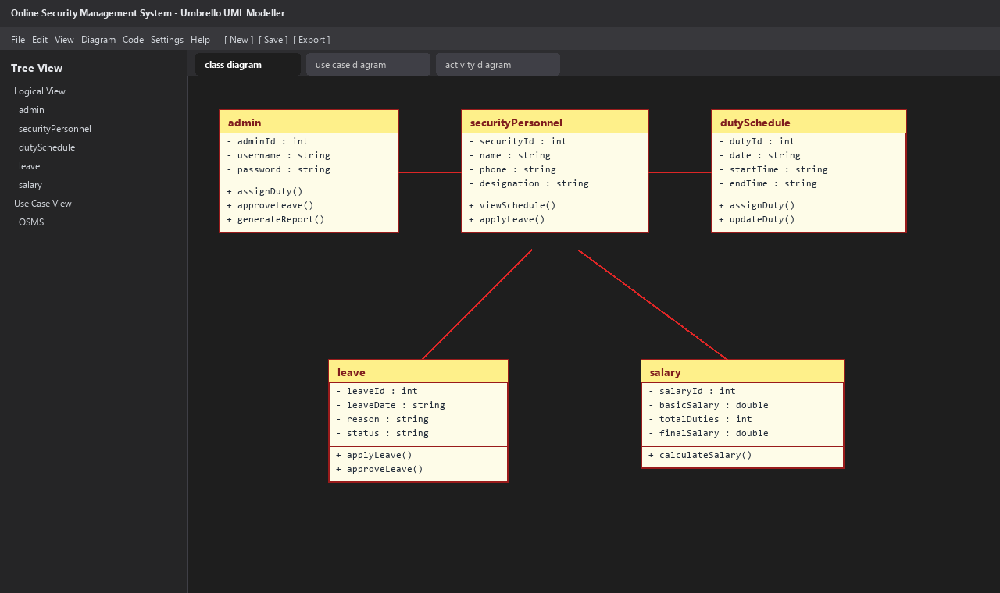
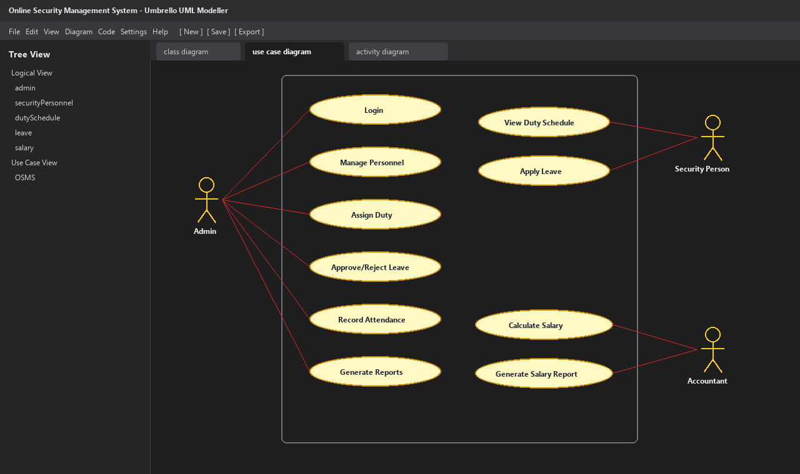
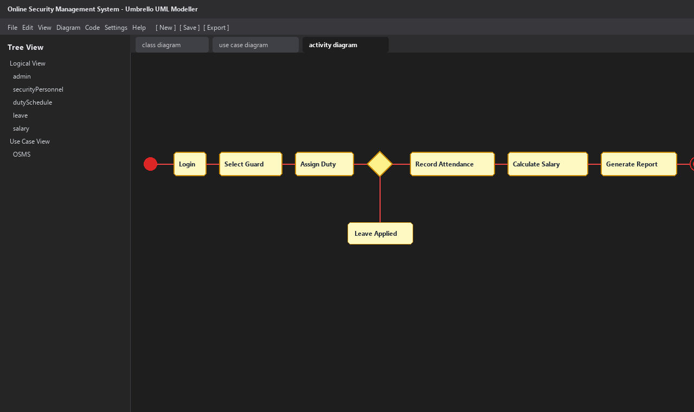

# Experiment 07: UML Diagrams for a College Security Management System

| Attribute | Details |
| :--- | :--- |
| **Experiment No.** | 07 |
| **Tools Used** | Umbrello UML Modeller |
| **Course Outcome** | CO1 |

---

## Problem Statement
A college employs security personnel assigned duties across campus locations with dates, start/end times, leave tracking, and monthly salary calculation. Develop a **Class Diagram**, **Use Case Diagram**, and **Activity Diagram** to automate the **Online Security Management System (OSMS)**.

## Aim
To design the Class diagram, Use Case diagram, and Activity diagram for a College Security Management System.

## Software / Tools Required
- Umbrello UML Modeller / StarUML
- Windows / Linux PC

## Theory
- **Static View (Class Diagram):** Models `Admin`, `SecurityPersonnel`, `DutySchedule`, `Leave`, and `Salary`.
- **Functional View (Use Case Diagram):** Actors `Administrator`, `Security Person`, and `Accountant` interacting with `Login`, `Assign Duty`, `View Duty Schedule`, `Apply Leave`, `Approve/Reject Leave`, `Record Attendance`, `Calculate Salary`, and `Generate Reports`.
- **Dynamic View (Activity Diagram):** End-to-end flow from Login → Select Personnel → Assign Duty → Leave Decision → Record Attendance → Calculate Salary → Generate Report → Logout.

## Procedure
1. Launch Umbrello and create project `Online Security Management System`.
2. Build the **Class Diagram** with `Admin`, `SecurityPersonnel`, `DutySchedule`, `Leave`, and `Salary`.
3. Build the **Use Case Diagram** with actors `Admin`, `Security Person`, and `Accountant`.
4. Build the **Activity Diagram** including the leave-approval decision diamond.
5. Verify multiplicities, relationships, and export images.

## Diagram Sources
- Class Diagram: [`diagrams/class_diagram.mmd`](./diagrams/class_diagram.mmd)
- Activity Diagram: [`diagrams/activity_diagram.mmd`](./diagrams/activity_diagram.mmd)

## Output Screenshots

### 1. Class Diagram – Security Management System

### 2. Use Case Diagram – Security Management System

### 3. Activity Diagram – Security Management System

## Expected Output
- Complete Class, Use Case, and Activity diagrams covering duty scheduling, leave management, and salary calculation.

## Result
Thus the Class, Use Case, and Activity diagrams for the College Security Management System were designed and verified using the UML modelling tool.

## Viva Voce Questions
1. **What is multiplicity?** The number of instances of one class associated with one instance of another (e.g., `1..*`).
2. **What is a system boundary?** A rectangle in a use case diagram separating system functions from external actors.
3. **Which diagram shows static structure?** The Class diagram.
4. **What is a swimlane?** A partition in an activity diagram grouping actions by responsible actor.
5. **What is generalization?** An inheritance relationship where a specialized class/actor inherits from a parent.
