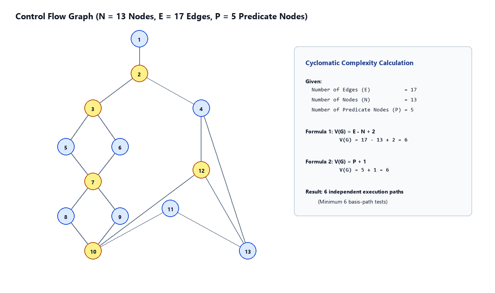
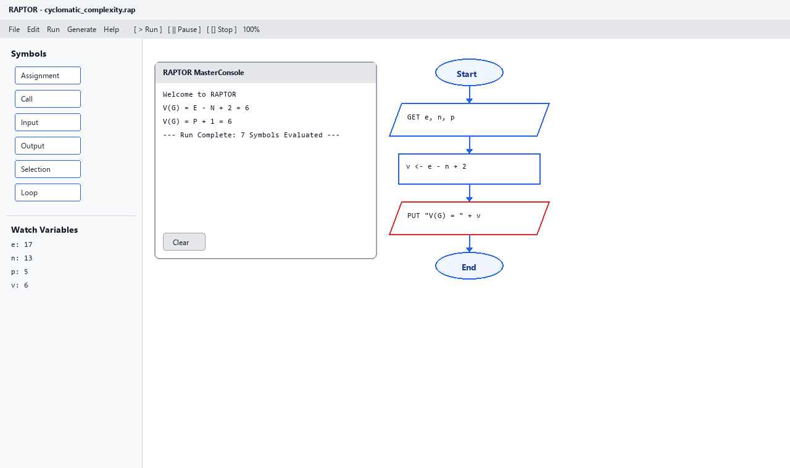

# Experiment 08: Cyclomatic Complexity of a Flow Graph

| Attribute | Details |
| :--- | :--- |
| **Experiment No.** | 08 |
| **Tools Used** | RAPTOR |
| **Course Outcome** | CO1 |

---

## Problem Statement
Find the Cyclomatic Complexity for a control flow graph having:
- Number of Edges ($E$) = **17**
- Number of Nodes ($N$) = **13**
- Number of Predicate Nodes ($P$) = **5**

Verify the result using $V(G) = E - N + 2$ and $V(G) = P + 1$.

## Aim
To calculate the cyclomatic complexity of a flow graph with 17 edges, 13 nodes, and 5 predicate nodes, and verify the result using the alternate formula in RAPTOR.

## Software / Tools Required
- RAPTOR
- Calculator / Python

## Theory
Cyclomatic complexity (Thomas J. McCabe, 1976) measures the number of linearly independent paths through a program's control flow graph:
1. $V(G) = E - N + 2P_{comp}$ (for a single connected component, $V(G) = E - N + 2$).
2. $V(G) = \pi + 1$ where $\pi$ (or $P$) is the number of predicate/decision nodes.
3. $V(G) = \text{Regions} + 1$.

For $E = 17, N = 13, P = 5$:
- $V(G) = 17 - 13 + 2 = 6$
- $V(G) = 5 + 1 = 6$

This means at least **6 independent test cases** are required for basis path testing (low/simple risk range 1–10).

## Procedure
1. Note the given graph parameters: $E = 17$, $N = 13$, $P = 5$.
2. Draw the Control Flow Graph and verify node, edge, and predicate counts.
3. In RAPTOR, read `e`, `n`, `p` via Input symbols.
4. Compute `v1 ← e - n + 2` and `v2 ← p + 1` in Assignment symbols.
5. Output both values and confirm `v1 == v2 == 6`.

## Artifacts & Runnable Script
- Control Flow Graph Diagram: [`cfg.mmd`](./cfg.mmd)
- Verification Script: [`cyclomatic_complexity.py`](./cyclomatic_complexity.py)

## Output Screenshots

### 1. Control Flow Graph (N=13, E=17, P=5)

### 2. RAPTOR Cyclomatic Complexity Computation & MasterConsole

## Expected Output
- `V(G) = E - N + 2 = 17 - 13 + 2 = 6`
- `V(G) = P + 1 = 5 + 1 = 6`

## Result
Thus the cyclomatic complexity of the given flow graph was calculated as **V(G) = 6** using both formulae, indicating six independent execution paths.

## Viva Voce Questions
1. **Who introduced cyclomatic complexity?** Thomas J. McCabe in 1976.
2. **What is a predicate node?** A decision node with two or more outgoing edges.
3. **What is basis path testing?** A white-box testing technique designing test cases to cover every independent path at least once.
4. **What does $V(G)=6$ tell the tester?** At least 6 test cases are needed to cover all independent paths.
5. **Is it white-box or black-box?** White-box, because it relies on the internal control-flow structure.
