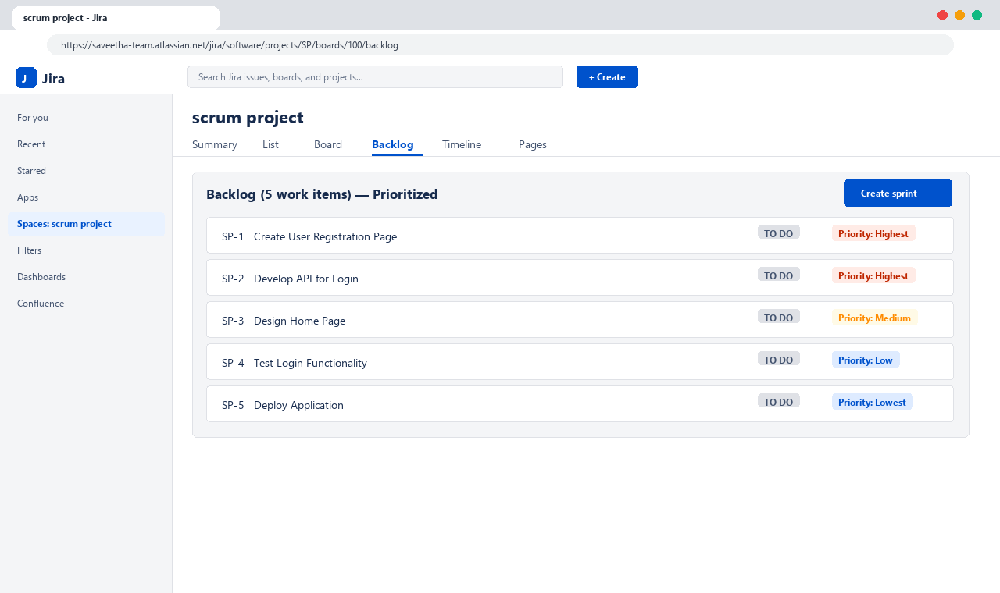
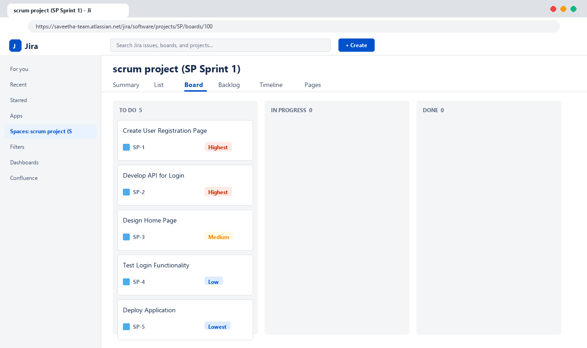
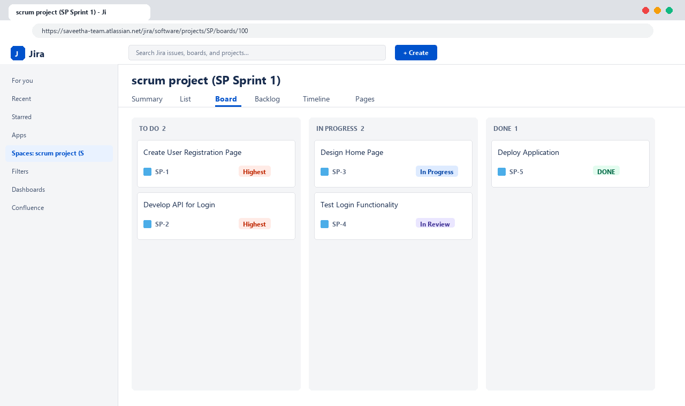

# Experiment 09: Creating a Scrum Project with Backlog and Sprint in Jira

| Attribute | Details |
| :--- | :--- |
| **Experiment No.** | 09 |
| **Tools Used** | Jira Software (Cloud) |
| **Course Outcome** | CO2 |

---

## Problem Statement
Create a Scrum Project in Jira. Add a backlog with at least 5 items, prioritize the backlog, create a 1-week sprint, move backlog items into the sprint, start the sprint, and capture screenshots of the sprint board at the start and end of the sprint.

## Aim
To create a Scrum project in Jira, add user stories to the product backlog, plan and start a 1-week sprint, and track progress on the sprint board.

## Software / Tools Required
- Jira Software (Cloud)
- Web Browser & Atlassian Account

## Theory
Scrum is an Agile framework delivering working software in fixed-length iterations (sprints, 1–4 weeks):
- **Roles:** Product Owner, Scrum Master, Development Team.
- **Artefacts:** Product Backlog, Sprint Backlog, Increment.
- **Events:** Sprint Planning, Daily Scrum, Sprint Review, Sprint Retrospective.

## Procedure
1. Login to Jira (`https://id.atlassian.com/login`).
2. Create a **Team-managed Scrum project** named `scrum project` (Key `SP`).
3. Add 5 backlog items:
   - `SP-1`: Create User Registration Page
   - `SP-2`: Develop API for Login
   - `SP-3`: Design Home Page
   - `SP-4`: Test Login Functionality
   - `SP-5`: Deploy Application
4. Prioritize the backlog (set Highest priority on `SP-1` and `SP-2`).
5. Click **Create Sprint**, move all 5 items into `SP Sprint 1`, set duration to **1 week**, and click **Start Sprint**.
6. Capture the **Start of Sprint** board (all 5 tasks in To Do).
7. Simulate progress by moving `SP-3` → In Progress, `SP-4` → In Review, `SP-5` → Done, and capture the **End of Sprint** board.

## Backlog Data Artifact
See [`sprint-backlog.json`](./sprint-backlog.json).

## Output Screenshots

### 1. Scrum Project Creation & Prioritized Backlog

### 2. Sprint Planning & Start of Sprint Board

### 3. Sprint Board at End of Simulation

## Expected Output
- Scrum project with prioritized backlog, active 1-week sprint, and sprint board showing task transitions from To Do to In Progress, In Review, and Done.

## Result
Thus a Scrum project was created in Jira, backlog items were added and prioritized, a 1-week sprint was started, and progress was tracked on the sprint board.

## Viva Voce Questions
1. **What is a sprint?** A fixed time-box (1–4 weeks) during which a usable increment is built.
2. **What is a product backlog?** An ordered list of all features, fixes, and enhancements needed for the product.
3. **What is a story point?** A relative unit estimating effort and complexity of a user story.
4. **What is a burndown chart?** A graph plotting remaining work versus time in a sprint.
5. **Who prioritizes the product backlog?** The Product Owner.
