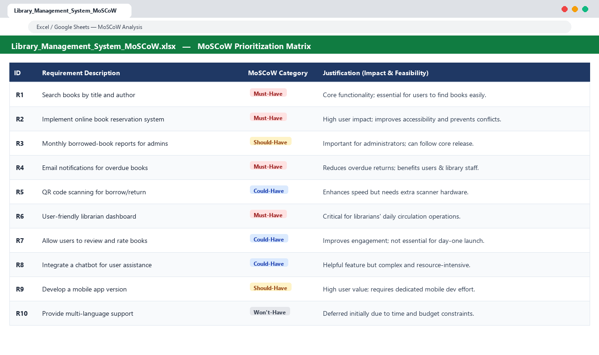

# Experiment 10: MoSCoW Prioritization of Library Management System Requirements

| Attribute | Details |
| :--- | :--- |
| **Experiment No.** | 10 |
| **Tools Used** | Microsoft Excel / Google Sheets |
| **Course Outcome** | CO2 |

---

## Problem Statement
Categorize 10 given requirements for a **Library Management System** using the **MoSCoW Method** (*Must-Have, Should-Have, Could-Have, Won't-Have*) based on user/stakeholder impact and feasibility (time, budget, resources).

## Aim
To categorize and justify the requirements of a Library Management System using the MoSCoW prioritization technique in Excel / Google Sheets.

## Software / Tools Required
- Microsoft Excel or Google Sheets

## Theory
MoSCoW (from DSDM) partitions requirements into four buckets:
- **Must-Have:** Non-negotiable for release viability.
- **Should-Have:** Important, high-value, but not vital for day-one launch.
- **Could-Have:** Desirable enhancements included if capacity permits.
- **Won't-Have (this time):** Explicitly deferred out of current release scope.

## Procedure
1. Create a new workbook `Library_Management_System_MoSCoW.xlsx`.
2. Add columns: `Requirement ID`, `Requirement Description`, `MoSCoW Category`, `Justification`.
3. Enter all 10 Library Management System requirements.
4. Evaluate each requirement on stakeholder impact and resource feasibility.
5. Assign MoSCoW categories, apply colour-coded formatting, and save.

## Prioritization Matrix

| ID | Requirement | MoSCoW Category | Justification |
| :---: | :--- | :---: | :--- |
| R1 | Search books by title and author | **Must-Have** | Core functionality; essential for users to find books easily. |
| R2 | Online book reservation system | **Must-Have** | High user impact; prevents conflicts and improves efficiency. |
| R3 | Monthly borrowed-books reports for admin | **Should-Have** | Important for administration; can follow core launch. |
| R4 | Email notifications for overdue books | **Must-Have** | Reduces overdue returns; high impact, low effort. |
| R5 | QR code scanning for borrow/return | **Could-Have** | Enhances speed but requires additional hardware setup. |
| R6 | User-friendly librarian dashboard | **Must-Have** | Critical for daily library operations. |
| R7 | Allow users to review and rate books | **Could-Have** | Improves engagement; not critical initially. |
| R8 | Integrate a chatbot for user assistance | **Could-Have** | Helpful but resource-intensive. |
| R9 | Develop a mobile app version | **Should-Have** | High user value; needs extra development budget/time. |
| R10 | Provide multi-language support | **Won't-Have** | Deferred due to current time and budget constraints. |

## Deliverable Files
- Excel Workbook: [`Library_Management_System_MoSCoW.xlsx`](./Library_Management_System_MoSCoW.xlsx)
- CSV Export: [`Library_Management_System_MoSCoW.csv`](./Library_Management_System_MoSCoW.csv)

## Output Screenshot

## Expected Output
A formatted spreadsheet containing all 10 categorized and justified requirements.

## Result
Thus the requirements of the Library Management System were prioritized using the MoSCoW method with suitable justifications and saved as a spreadsheet.

## Viva Voce Questions
1. **Expand MoSCoW.** Must have, Should have, Could have, Won't have (this time).
2. **Why are the 'o's lowercase?** Only to make the acronym pronounceable.
3. **What criteria were used?** User/stakeholder impact and time/budget/resource feasibility.
4. **Name two other prioritization techniques.** Kano model and 100-point cumulative voting (or AHP).
5. **What does Won't-Have mean?** Out of scope for the current release, reconsidered in future iterations.
