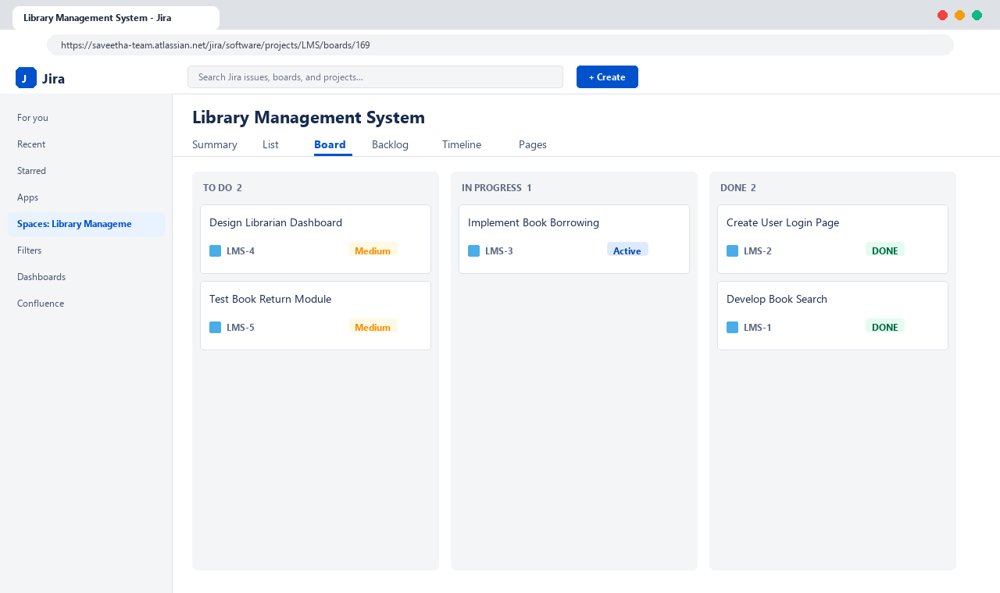
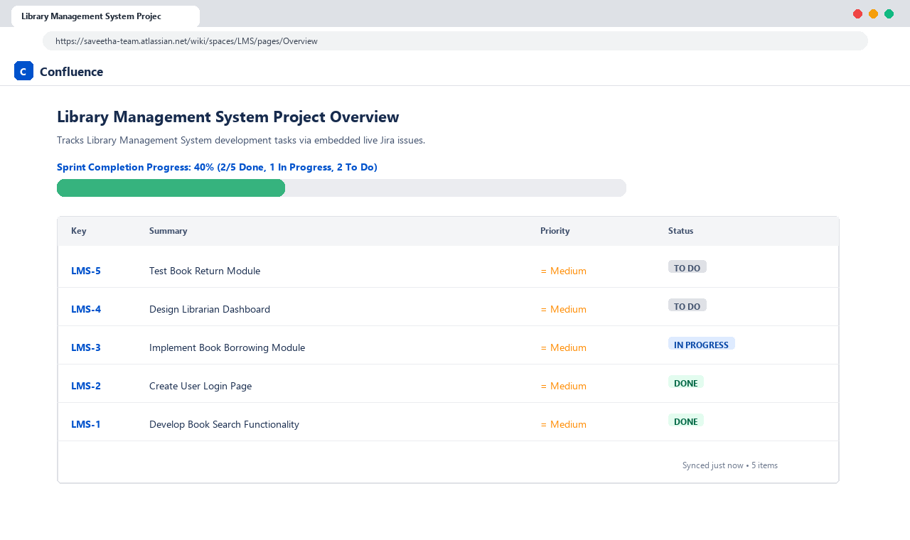

# Experiment 11: Linking Jira Issues with Confluence for Progress Tracking

| Attribute | Details |
| :--- | :--- |
| **Experiment No.** | 11 |
| **Tools Used** | Jira & Confluence |
| **Course Outcome** | CO2 |

---

## Problem Statement
Link Jira tasks with Confluence to streamline tracking for the **Library Management System**:
- Create a Confluence page titled `"Library Management System Project Overview"`.
- Embed at least 5 Jira issues using the `/jira` macro with live statuses.
- Include a visual progress bar tracking sprint completion.

## Aim
To integrate Jira tasks of a Library Management System with a Confluence page using the Jira macro and track sprint completion visually.

## Software / Tools Required
- Jira Software (Cloud) & Confluence (Cloud)
- Web Browser

## Theory
Jira manages issues and sprints while Confluence manages documentation. Using the `/jira` macro (powered by JQL such as `project = LMS ORDER BY key ASC`), Confluence embeds live Jira tables that automatically reflect status changes made on the sprint board.

## Procedure
1. Create a Scrum project in Jira named `Library Management System` (Key: `LMS`).
2. Add 5 issues: `LMS-1` Develop Book Search Functionality, `LMS-2` Create User Login Page, `LMS-3` Implement Book Borrowing Module, `LMS-4` Design Librarian Dashboard, `LMS-5` Test Book Return Module.
3. Start Sprint 1 and move `LMS-1` and `LMS-2` to **Done**, `LMS-3` to **In Progress**, and keep `LMS-4` & `LMS-5` in **To Do** (40% complete).
4. In Confluence, create page `Library Management System Project Overview`.
5. Insert `/jira` macro showing Key, Summary, Assignee, Priority, and Status, plus a progress bar showing sprint completion.

## Confluence Page Source
See [`confluence-overview.md`](./confluence-overview.md).

## Output Screenshots

### 1. Jira LMS Project Backlog & Active Sprint Board

### 2. Confluence Page with Embedded Jira Macro & Progress Bar

## Expected Output
- Five Jira issues (`LMS-1` to `LMS-5`) embedded live inside Confluence with status badges and progress bar.

## Result
Thus Jira tasks were linked with a Confluence page, issues were embedded with live statuses and a progress bar, and tracking for the Library Management System was streamlined.

## Viva Voce Questions
1. **What is Confluence?** An Atlassian team workspace for documentation and knowledge sharing.
2. **How do you embed Jira issues?** Type `/jira` on the page and search or write a JQL query.
3. **What is JQL?** Jira Query Language used to filter and sort Jira issues.
4. **Do statuses update automatically?** Yes, the Jira macro displays live data synchronized from Jira.
5. **Why integrate Jira and Confluence?** To keep project specifications and real-time engineering progress in one connected place.
