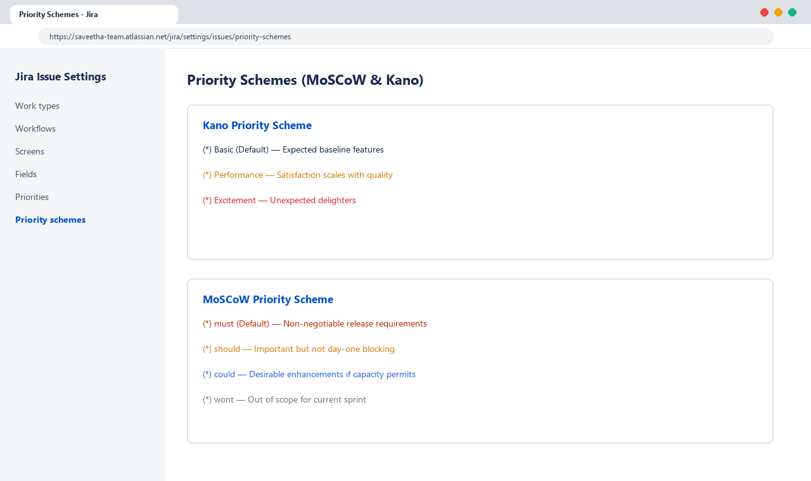
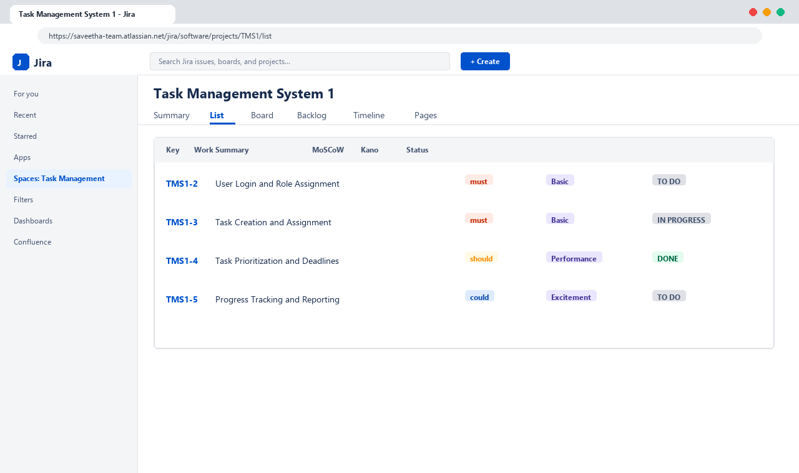

# Experiment 12: Prioritizing Task Management System Requirements using MoSCoW and Kano in Jira

| Attribute | Details |
| :--- | :--- |
| **Experiment No.** | 12 |
| **Tools Used** | Jira Software (Cloud) |
| **Course Outcome** | CO2 |

---

## Problem Statement
Design a **Task Management System** with four core features (`User Login and Role Assignment`, `Task Creation and Assignment`, `Task Prioritization and Deadlines`, `Progress Tracking and Reporting`) and prioritize them using both **MoSCoW** and **Kano** models in Jira.

## Aim
To model the requirements of a Task Management System as Jira issues and classify them using the MoSCoW and Kano prioritization models.

## Software / Tools Required
- Jira Software (Cloud) – Scrum project & Priority Schemes / Labels
- Web Browser

## Theory
Combining **MoSCoW** (business necessity) with the **Kano Model** (Noriaki Kano, 1984 – customer satisfaction impact) balances release urgency against user delight:
- **Basic (Must-be):** Expected baseline; absence causes dissatisfaction.
- **Performance (One-dimensional):** More/better execution yields proportional satisfaction.
- **Excitement (Attractive):** Unexpected delighters.

## Prioritization Table

| Key | Requirement | MoSCoW | Kano |
| :---: | :--- | :---: | :---: |
| TMS1-2 | User Login and Role Assignment | Must-Have | Basic |
| TMS1-3 | Task Creation and Assignment | Must-Have | Basic |
| TMS1-4 | Task Prioritization and Deadlines | Should-Have | Performance |
| TMS1-5 | Progress Tracking and Reporting | Could-Have | Excitement |

## Deliverable Data
See [`tms-prioritization.csv`](./tms-prioritization.csv).

## Output Screenshots

### 1. Jira Priority Schemes (MoSCoW & Kano)

### 2. Sprint Board & List View with Assigned Priorities

## Expected Output
Scrum project `Task Management System 1` with four prioritized tasks in Sprint 1 displaying MoSCoW and Kano classifications.

## Result
Thus the requirements of the Task Management System were created in Jira and prioritized using the MoSCoW and Kano models.

## Viva Voce Questions
1. **What is the Kano model?** A framework classifying features by their effect on customer satisfaction.
2. **Give an example of a Basic feature.** User login—users expect it by default.
3. **Give an example of an Excitement feature.** Automated progress tracking and visual reporting.
4. **How are MoSCoW/Kano stored in Jira?** Using Priority Schemes, labels, or custom select fields.
5. **Why combine MoSCoW and Kano?** MoSCoW captures business criticality while Kano captures user satisfaction.
