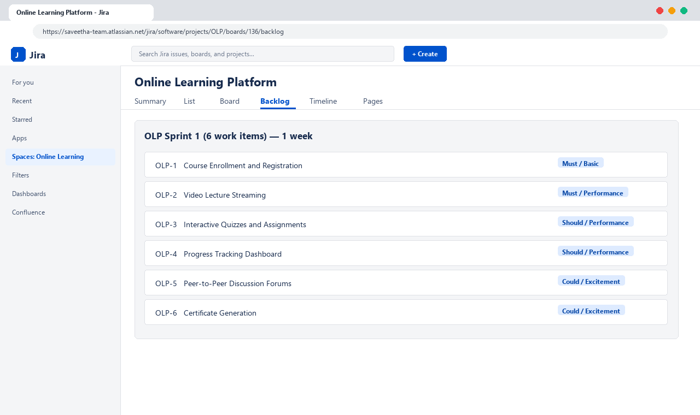
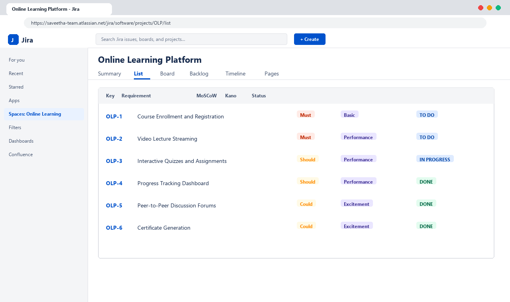

# Experiment 13: Prioritizing Online Learning Platform Requirements using MoSCoW and Kano in Jira

| Attribute | Details |
| :--- | :--- |
| **Experiment No.** | 13 |
| **Tools Used** | Jira Software (Cloud) |
| **Course Outcome** | CO2 |

---

## Problem Statement
Develop an **Online Learning Platform** with six functionalities (`Course Enrollment and Registration`, `Video Lecture Streaming`, `Interactive Quizzes and Assignments`, `Progress Tracking Dashboard`, `Peer-to-Peer Discussion Forums`, `Certificate Generation`) and prioritize them in Jira using MoSCoW and Kano techniques.

## Aim
To categorize and prioritize the functional requirements of an Online Learning Platform in Jira using the MoSCoW and Kano techniques.

## Prioritization Matrix

| Key | Requirement | MoSCoW | Kano |
| :---: | :--- | :---: | :---: |
| OLP-1 | Course Enrollment and Registration | Must-Have | Basic |
| OLP-2 | Video Lecture Streaming | Must-Have | Performance |
| OLP-3 | Interactive Quizzes and Assignments | Should-Have | Performance |
| OLP-4 | Progress Tracking Dashboard | Should-Have | Performance |
| OLP-5 | Peer-to-Peer Discussion Forums | Could-Have | Excitement |
| OLP-6 | Certificate Generation | Could-Have | Excitement |

## Deliverable Data
See [`olp-prioritization.csv`](./olp-prioritization.csv).

## Output Screenshots

### 1. Online Learning Platform Backlog & Sprint 1

### 2. Sprint Board & Priority List View (MoSCoW & Kano)

## Expected Output
Scrum project `Online Learning Platform` (`OLP`) with all six tasks scheduled in Sprint 1 and tagged with MoSCoW and Kano priorities.

## Result
Thus the requirements of the Online Learning Platform were created in Jira and categorized and prioritized using the MoSCoW and Kano techniques.

## Viva Voce Questions
1. **Why is course enrollment a Basic feature?** Without enrollment learners cannot access any course.
2. **Why is certificate generation an Excitement feature?** It delights users upon completion without blocking core learning.
3. **What is a Performance feature?** Satisfaction scales proportionally with quality (e.g., smooth HD video streaming).
4. **How do you filter by label in Jira?** Using the board/backlog filter or JQL `labels = Kano-Basic`.
5. **Can Kano categories evolve over time?** Yes—excitement features gradually become performance and eventually basic expectations.
