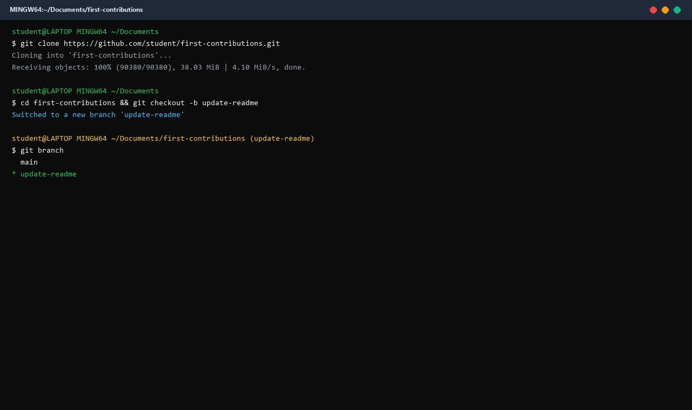
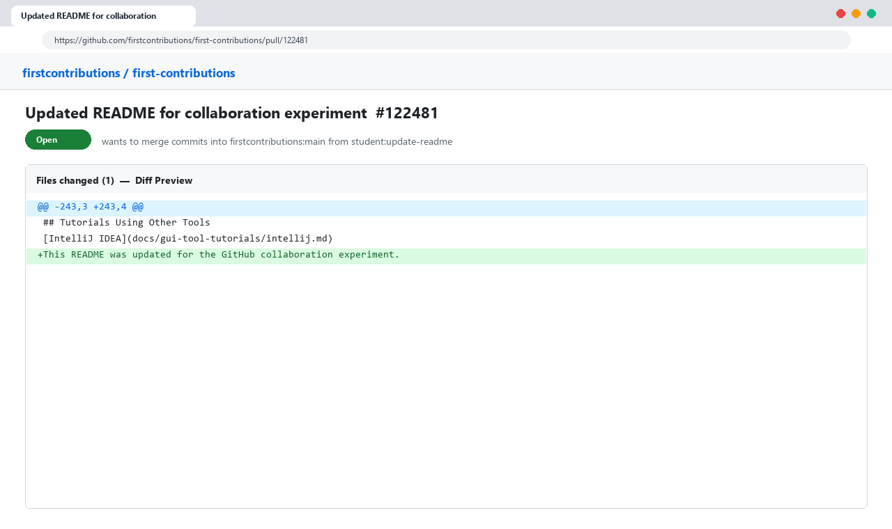

# Experiment 14: Fork-and-Pull-Request Collaboration Workflow using Git and GitHub

| Attribute | Details |
| :--- | :--- |
| **Experiment No.** | 14 |
| **Tools Used** | Git / GitHub, Visual Studio Code |
| **Course Outcome** | CO3 |

---

## Problem Statement
Demonstrate collaborative open-source contribution using the **Fork-and-Pull-Request** workflow: fork a public repository, clone locally, create a feature branch, modify `README.md`, commit, push, open a Pull Request, review, respond to feedback, and submit the PR link.

## Aim
To collaborate on a GitHub project using the fork-and-pull-request workflow.

## Procedure & Commands
```bash
# 1. Clone the forked repository
git clone https://github.com/<your-username>/first-contributions.git
cd first-contributions

# 2. Create a feature branch
git checkout -b update-readme
git branch

# 3. Edit README.md, stage, commit, and push
git status
git add README.md
git commit -m "Updated README for collaboration experiment"
git push -u origin update-readme

# 4. Address review feedback with follow-up commits
git add .
git commit -m "Addressed review comments"
git push
```
See [`commands.sh`](./commands.sh).

## Output Screenshots

### 1. Fork & Clone in Git Bash with Feature Branch


### 2. Commit, Push & Pull Request Submission


## Expected Output
- Repository forked, cloned, modified on `update-readme` branch, pushed, and Pull Request opened against upstream `main`.

## Result
Thus the fork-and-pull-request workflow was demonstrated end-to-end using Git and GitHub.

## Viva Voce Questions
1. **Differentiate fork and clone.** Fork creates a server-side copy under your GitHub account; clone downloads a local copy.
2. **What is a Pull Request?** A formal request to review and merge commits from one branch into another.
3. **Why work on a separate branch?** To isolate changes and keep `main` clean and deployable.
4. **What happens when you push new commits to an open PR branch?** The PR updates automatically.
5. **Who can merge a PR into the upstream repository?** Only maintainers with write access to the upstream repo.
