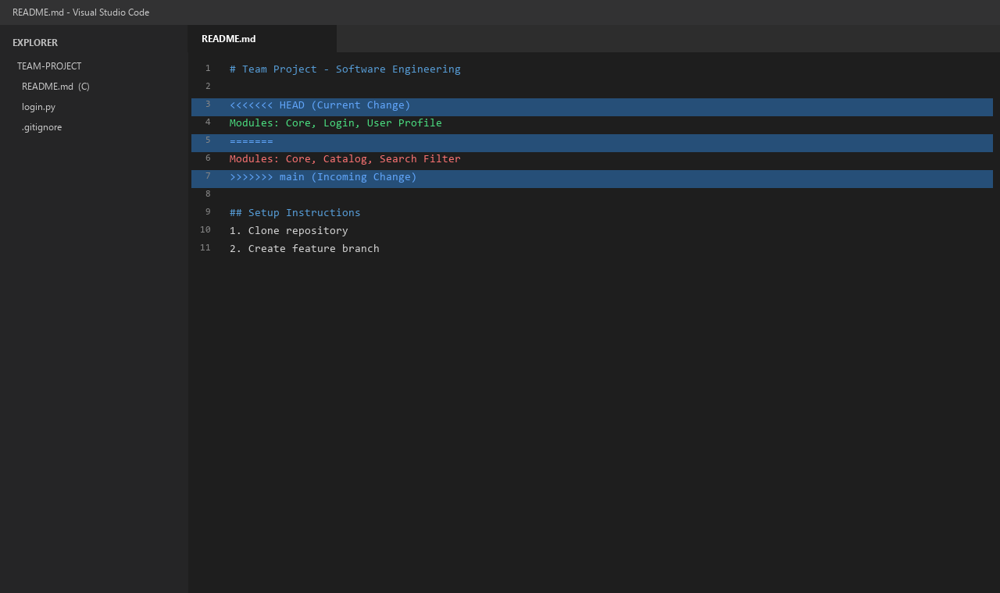
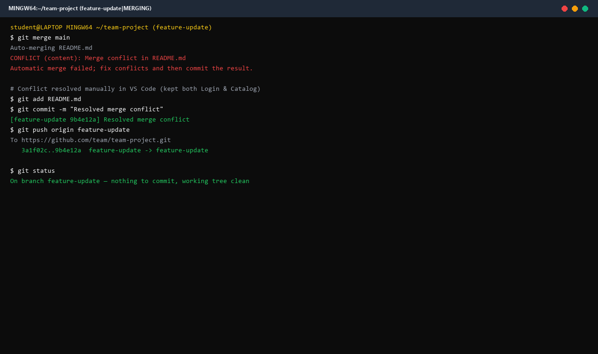

# Experiment 15: Working with Git Branches and Resolving Merge Conflicts

| Attribute | Details |
| :--- | :--- |
| **Experiment No.** | 15 |
| **Tools Used** | Git / GitHub, Visual Studio Code |
| **Course Outcome** | CO3 |

---

## Problem Statement
Demonstrate working with Git branches, merging `main` into a feature branch, manually resolving merge conflicts, committing the resolved merge, pushing to GitHub, and creating a Pull Request.

## Aim
To work with Git branches in a collaborative workflow, manually resolve merge conflicts between `main` and a feature branch, and submit a Pull Request.

## Theory
A merge conflict occurs when two branches modify the same lines of a file differently. Git inserts conflict markers:
```text
<<<<<<< HEAD
Your feature branch changes
=======
Changes from main branch
>>>>>>> main
```
Resolution requires keeping the desired combined content, removing the markers, staging with `git add`, and committing with `git commit`.

## Procedure & Commands
```bash
git clone <repository_url>
cd <repository_name>
git checkout -b feature-update
# Edit README.md
git add README.md
git commit -m "Updated README"
git push -u origin feature-update

# Sync main and merge into feature branch
git checkout main
git pull origin main
git checkout feature-update
git merge main

# After resolving conflict markers in README.md:
git add README.md
git commit -m "Resolved merge conflict"
git push origin feature-update
```
A runnable local conflict simulation script is included in [`simulate_conflict.sh`](./simulate_conflict.sh).

## Output Screenshots

### 1. Merge Conflict Detection & VS Code Markers


### 2. Conflict Resolution, Commit & Pull Request


## Expected Output
- `CONFLICT (content): Merge conflict in README.md` triggered, manually resolved, committed as `"Resolved merge conflict"`, pushed, and PR opened.

## Result
Thus Git branches were used for collaboration, the merge conflict between `feature-update` and `main` was resolved manually, and the merged branch was pushed with a pull request.

## Viva Voce Questions
1. **When does a merge conflict occur?** When two branches modify the same region of a file incompatibly.
2. **What do `<<<<<<<`, `=======`, `>>>>>>>` indicate?** Start of current branch change, separator, and end of incoming branch change.
3. **How do you abort a merge?** `git merge --abort`.
4. **Differentiate `git fetch` and `git pull`.** `fetch` downloads remote refs without merging; `pull` equals `fetch` + `merge`.
5. **What is a fast-forward merge?** Advancing the branch pointer directly when there are no divergent commits.
