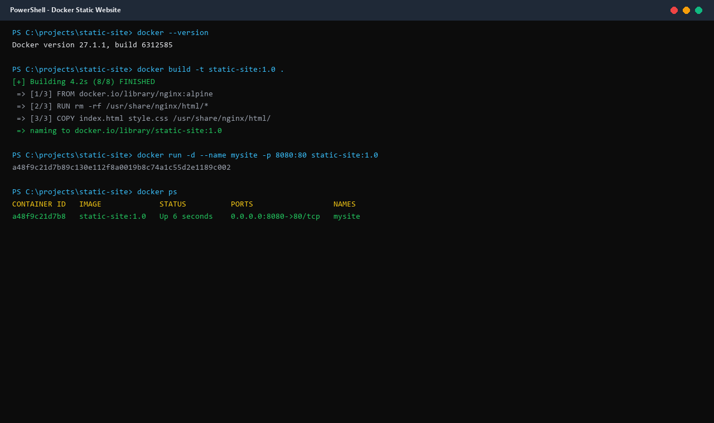
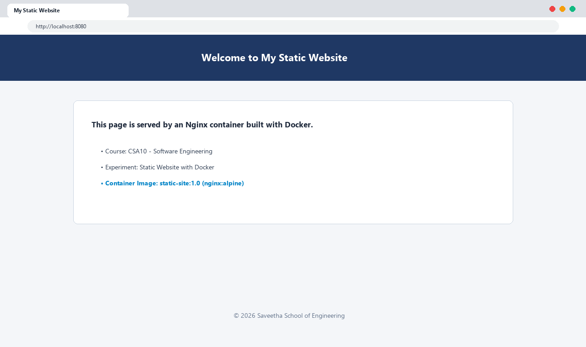

# Experiment 16: Static Website Containerized and Served with Docker and Nginx

| Attribute | Details |
| :--- | :--- |
| **Experiment No.** | 16 |
| **Tools Used** | Docker, Nginx |
| **Course Outcome** | CO3 |

---

## Problem Statement
Create a simple static website (`index.html` and `style.css`), write a `Dockerfile` to serve it using Nginx, build the Docker image, run the container, and access the website in a browser.

## Aim
To containerize and serve a static website using Docker and Nginx.

## Software / Tools Required
- Docker Desktop / Docker Engine
- Visual Studio Code
- Web Browser

## Procedure & Commands
```bash
docker --version
docker build -t static-site:1.0 .
docker images
docker run -d --name mysite -p 8080:80 static-site:1.0
docker ps
# Open http://localhost:8080
docker stop mysite && docker rm mysite
```

## Deliverable Files
- [`index.html`](./index.html)
- [`style.css`](./style.css)
- [`Dockerfile`](./Dockerfile)

## Output Screenshots

### 1. Docker Build & Running Container (`docker build`, `docker ps`)


### 2. Static Website Served at `http://localhost:8080`


## Expected Output
- Image `static-site:1.0` builds cleanly.
- `docker ps` shows port mapping `0.0.0.0:8080->80/tcp`.
- Browser at `http://localhost:8080` renders **Welcome to My Static Website**.

## Result
Thus a static website was created, containerized with a Dockerfile using Nginx, built into an image, run as a container, and accessed successfully in a browser.

## Viva Voce Questions
1. **Difference between image and container?** An image is a read-only template; a container is a running instance of an image.
2. **What does `EXPOSE` do?** Documents the container's listening port; actual publishing uses `-p`.
3. **Purpose of `-d` in `docker run`?** Runs the container in detached background mode.
4. **Where does official Nginx serve static files from?** `/usr/share/nginx/html`.
5. **Why use `alpine` as the base image?** It provides a minimal Linux footprint, reducing image size and attack surface.
