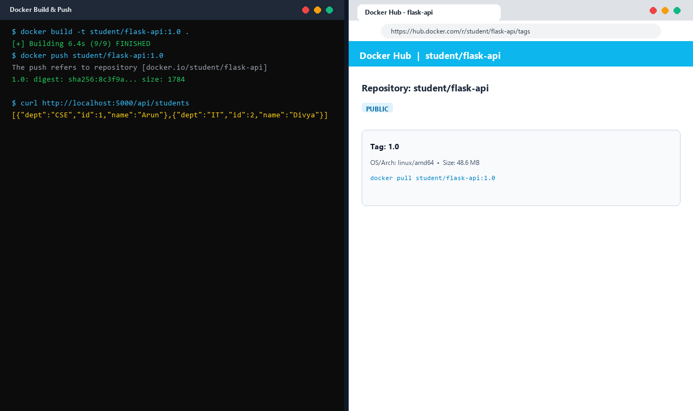
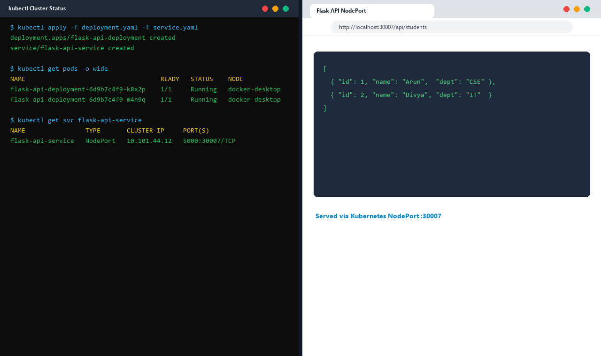

# Experiment 17: Flask API Containerized with Docker, Pushed to Docker Hub and Deployed on Kubernetes

| Attribute | Details |
| :--- | :--- |
| **Experiment No.** | 17 |
| **Tools Used** | Docker, Docker Hub, Kubernetes (`kubectl`) |
| **Course Outcome** | CO3 |

---

## Problem Statement
Create a Python Flask REST API (`app.py`), containerize it with Docker, push the image to Docker Hub, create Kubernetes `Deployment` and `NodePort` `Service` manifests, apply them, and access the API via NodePort `30007`.

## Aim
To containerize a Flask API with Docker, publish it to Docker Hub, and deploy it onto a Kubernetes cluster exposed via NodePort.

## Procedure & Commands
```bash
docker build -t <dockerhub-username>/flask-api:1.0 .
docker login
docker push <dockerhub-username>/flask-api:1.0

kubectl apply -f deployment.yaml
kubectl apply -f service.yaml
kubectl get deployments
kubectl get pods -o wide
kubectl get svc
curl http://localhost:30007/api/students
```

## Deliverable Files
- [`app.py`](./app.py)
- [`requirements.txt`](./requirements.txt)
- [`Dockerfile`](./Dockerfile)
- [`deployment.yaml`](./deployment.yaml)
- [`service.yaml`](./service.yaml)

## Output Screenshots

### 1. Docker Build, Push to Docker Hub & `curl` Test


### 2. Kubernetes Pods, Service (`kubectl get`) & NodePort API Output


## Expected Output
- 2/2 Pods in `Running` state; `flask-api-service` exposed on `5000:30007/TCP`.
- `http://localhost:30007/api/students` returns JSON list of students.

## Result
Thus a Flask API was containerized with Docker, pushed to Docker Hub, deployed on Kubernetes, and verified via NodePort.

## Viva Voce Questions
1. **What is a Pod?** The smallest deployable unit in Kubernetes wrapping one or more containers.
2. **What is the NodePort range?** `30000` – `32767`.
3. **Role of `selector` in a Service?** Matches Pod labels to route traffic to the right pods.
4. **Why must Flask bind to `0.0.0.0`?** To accept external traffic outside the container loopback interface.
5. **What does `kubectl apply -f` do?** Declaratively creates or updates cluster resources from YAML.
