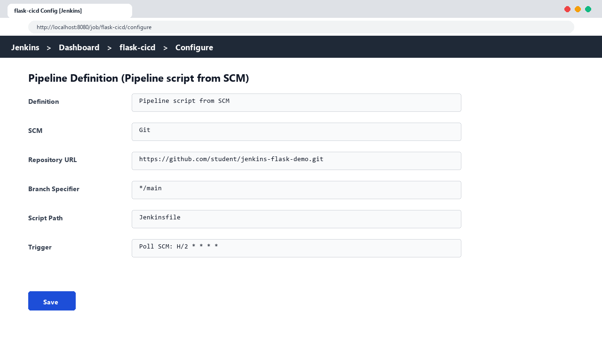
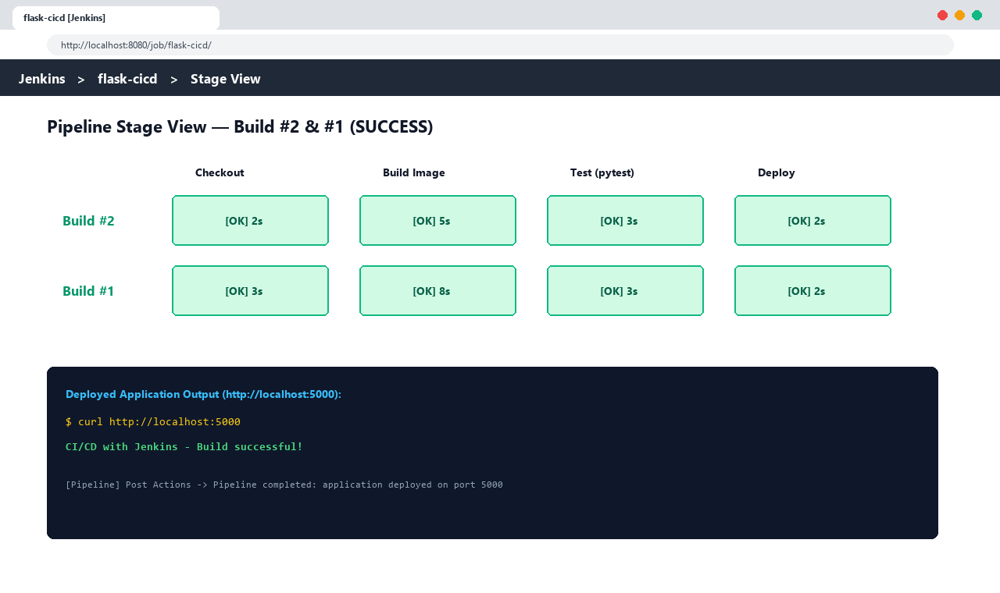

# Experiment 18: CI/CD Pipeline with Jenkins for a Containerized Application

| Attribute | Details |
| :--- | :--- |
| **Experiment No.** | 18 |
| **Tools Used** | Jenkins, Docker, Pytest, GitHub |
| **Course Outcome** | CO4 |

---

## Problem Statement
Set up Jenkins and create a declarative CI/CD pipeline (`Jenkinsfile`) to automatically checkout, build a Docker image, run unit tests (`pytest`), and deploy a containerized Flask application.

## Aim
To set up Jenkins and build an automated CI/CD pipeline for a containerized Flask application.

## Pipeline Stages
1. **Checkout:** Pulls code from the `main` branch.
2. **Build Image:** Runs `docker build -t $IMAGE:$TAG .`.
3. **Test:** Executes `docker run --rm $IMAGE:$TAG pytest -q`.
4. **Deploy:** Replaces previous container and deploys on port `5000`.

## Deliverable Files
- [`app.py`](./app.py)
- [`test_app.py`](./test_app.py)
- [`requirements.txt`](./requirements.txt)
- [`Dockerfile`](./Dockerfile)
- [`Jenkinsfile`](./Jenkinsfile)

## Output Screenshots

### 1. Jenkins Setup & Pipeline Job Configuration

### 2. Jenkins Stage View (Checkout → Build → Test → Deploy) & Deployed App

## Expected Output
- All four stages green (`SUCCESS`) in Jenkins Stage View.
- `http://localhost:5000` displays `CI/CD with Jenkins - Build successful!`.

## Result
Thus Jenkins was configured and a declarative CI/CD pipeline was implemented to automatically build, test, and deploy the containerized application.

## Viva Voce Questions
1. **What is CI?** Continuous Integration—automatically building and testing code on every commit.
2. **What is a `Jenkinsfile`?** Pipeline-as-Code stored alongside application source code.
3. **Continuous Delivery vs Continuous Deployment?** Delivery requires manual approval before production release; Deployment releases automatically.
4. **How is Jenkins triggered on push?** Via a GitHub webhook or `pollSCM`.
5. **Default port of Jenkins?** `8080`.
