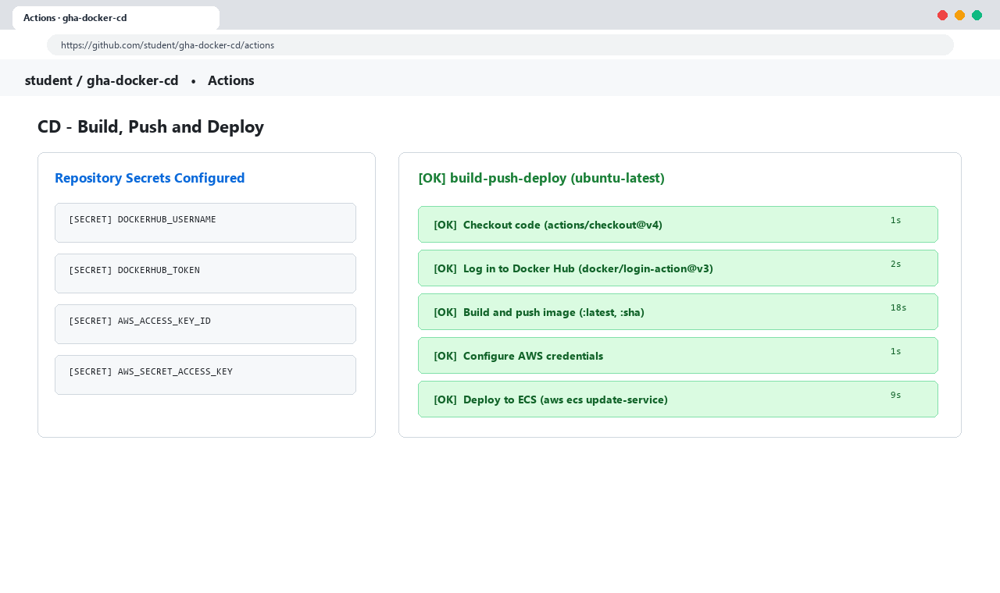
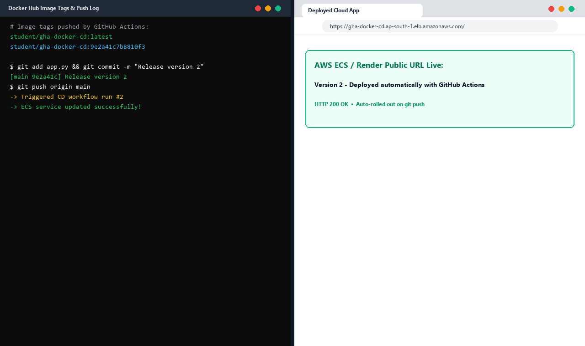

# Experiment 19: Continuous Deployment of a Dockerized Application using GitHub Actions

| Attribute | Details |
| :--- | :--- |
| **Experiment No.** | 19 |
| **Tools Used** | GitHub Actions, Docker Hub, AWS ECS / Render |
| **Course Outcome** | CO5 |

---

## Problem Statement
Implement Continuous Deployment using GitHub Actions: automatically build and push a Dockerized Flask application image to Docker Hub on every push to `main`, trigger cloud deployment, and verify rollouts when code changes.

## Aim
To implement automated Continuous Deployment using GitHub Actions, Docker Hub, and a cloud target.

## Deliverable Files
- [`app.py`](./app.py)
- [`requirements.txt`](./requirements.txt)
- [`Dockerfile`](./Dockerfile)
- [`.github/workflows/cd.yml`](./.github/workflows/cd.yml)

## Output Screenshots

### 1. GitHub Repository Secrets & Actions Workflow Run

### 2. Docker Hub Tags & Cloud Deployment Rollout (v1 → v2)

## Expected Output
- Workflow `CD - Build, Push and Deploy` completes with green checkmark.
- Docker Hub updated with `latest` and commit SHA tags; live endpoint reflects Version 1 and Version 2 automatically after push.

## Result
Thus Continuous Deployment was implemented with GitHub Actions to build, push, and deploy the Dockerized application automatically on every commit.

## Viva Voce Questions
1. **Where are workflow files stored?** `.github/workflows/`.
2. **What is a runner?** A virtual machine (`ubuntu-latest` or self-hosted) executing workflow jobs.
3. **Why use repository secrets?** To store tokens and keys encrypted outside source code.
4. **What does `actions/checkout` do?** Clones the repository workspace onto the runner.
5. **Why tag with `${{ github.sha }}`?** Provides immutable traceability and simple rollback to any commit.
