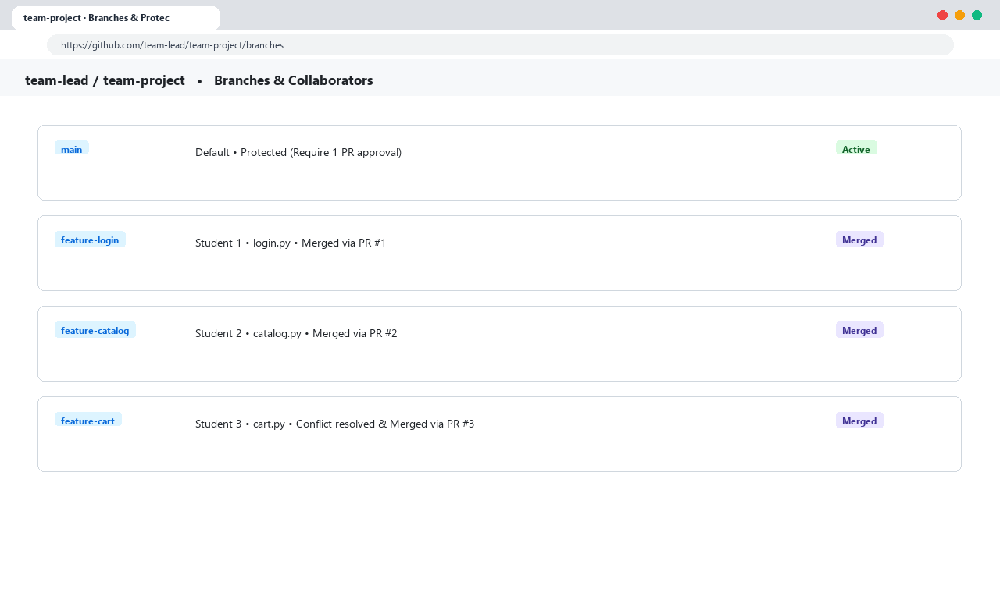
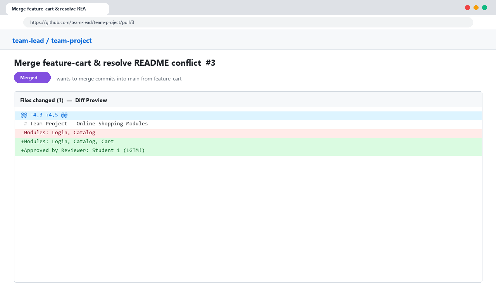

# Experiment 20: Team Project Repository with Branches, Pull Requests and README Documentation

| Attribute | Details |
| :--- | :--- |
| **Experiment No.** | 20 |
| **Tools Used** | Git / GitHub, Visual Studio Code |
| **Course Outcome** | CO5 |

---

## Problem Statement
Set up a team GitHub repository, create separate module branches (`feature-login`, `feature-catalog`, `feature-cart`), merge via reviewed Pull Requests, resolve a merge conflict in `README.md`, and document the team workflow.

## Aim
To implement multi-developer Git version control using module branches, code-reviewed Pull Requests, conflict resolution, and README documentation.

## Team Module Allocation
| Member | Module | Branch | Deliverable |
| :---: | :--- | :--- | :--- |
| Student 1 | Login / Auth | `feature-login` | [`login.py`](./login.py) |
| Student 2 | Product Catalog | `feature-catalog` | [`catalog.py`](./catalog.py) |
| Student 3 | Shopping Cart | `feature-cart` | [`cart.py`](./cart.py) |

## Deliverable Files
- [`login.py`](./login.py), [`catalog.py`](./catalog.py), [`cart.py`](./cart.py)
- [`TEAM_README.md`](./TEAM_README.md)

## Output Screenshots

### 1. Collaborators, Branch Protection & Module Branches

### 2. Pull Request Review, Conflict Resolution & Network Graph

## Expected Output
- Repository with protected `main`, three merged feature branches, resolved conflict, and complete team workflow README.

## Result
Thus a team GitHub repository was set up, modules were developed on separate branches, merged via reviewed pull requests, conflicts were resolved, and the workflow was documented.

## Viva Voce Questions
1. **What is branch protection?** Rules blocking direct pushes to `main` and requiring reviewed PRs or status checks.
2. **What is squash and merge?** Combining all PR commits into a single commit on the target branch.
3. **How do you invite collaborators?** Repository Settings → Collaborators → Add people.
4. **Why document workflow in README?** Ensures every contributor follows a uniform branching and review process.
5. **What is code review?** Peer inspection of proposed changes prior to merging.
