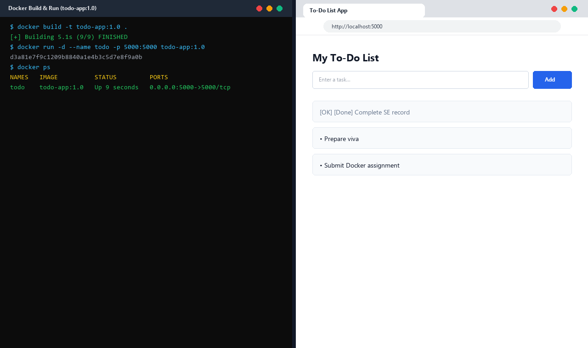
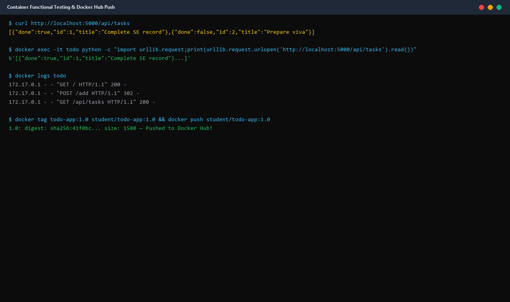

# Experiment 21: Containerizing a Python Flask To-Do Application using Docker

| Attribute | Details |
| :--- | :--- |
| **Experiment No.** | 21 |
| **Tools Used** | Docker, Python, Flask |
| **Course Outcome** | CO5 |

---

## Problem Statement
Write a Python Flask To-Do application (`app.py`, `templates/index.html`), create a `Dockerfile`, build and run the container locally, test functionality inside the container (`docker exec` & `curl`), and push the image to Docker Hub.

## Aim
To containerize, test, and publish a Python Flask To-Do list web application using Docker.

## Procedure & Commands
```bash
docker build -t todo-app:1.0 .
docker run -d --name todo -p 5000:5000 todo-app:1.0
curl http://localhost:5000/api/tasks
docker exec -it todo python -c "import urllib.request;print(urllib.request.urlopen('http://localhost:5000/api/tasks').read())"
docker logs todo
docker tag todo-app:1.0 <dockerhub-username>/todo-app:1.0
docker push <dockerhub-username>/todo-app:1.0
```

## Deliverable Files
- [`app.py`](./app.py), [`templates/index.html`](./templates/index.html)
- [`requirements.txt`](./requirements.txt), [`Dockerfile`](./Dockerfile), [`.dockerignore`](./.dockerignore)

## Output Screenshots

### 1. Docker Build & To-Do Web UI (`http://localhost:5000`)


### 2. Container Testing (`curl`, `docker exec`, `docker logs`) & Docker Hub Push


## Expected Output
- Image `todo-app:1.0` runs on port `5000`; tasks can be added, marked done, deleted, and queried at `/api/tasks`.
- Image published to `<dockerhub-username>/todo-app:1.0`.

## Result
Thus a Flask To-Do application was containerized using Docker, tested inside the container, and pushed to Docker Hub.

## Viva Voce Questions
1. **Why copy `requirements.txt` before source code?** Leverages Docker build layer caching so dependencies reinstall only when requirements change.
2. **What does `docker exec -it` do?** Runs an interactive command inside a running container.
3. **How to inspect container logs?** `docker logs <container>`.
4. **Purpose of `.dockerignore`?** Excludes files like `__pycache__` from the Docker build context.
5. **Why `python:3.11-slim`?** Smaller footprint, faster pulls, and fewer unnecessary packages.
