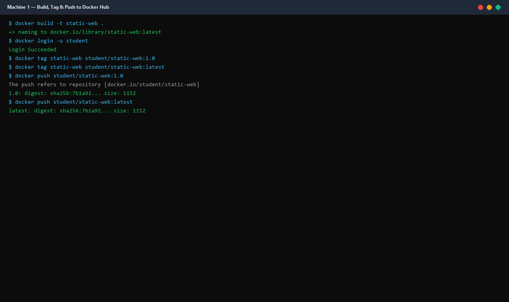
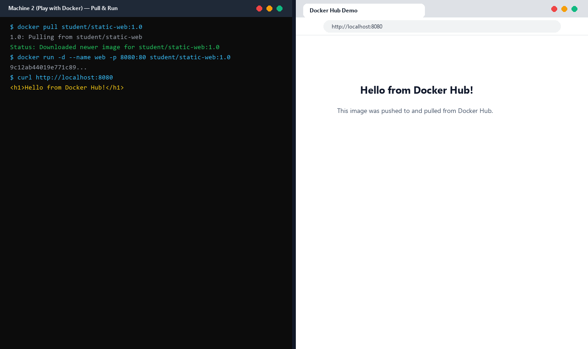

# Experiment 22: Push and Pull Docker Images using Docker Hub

| Attribute | Details |
| :--- | :--- |
| **Experiment No.** | 22 |
| **Tools Used** | Docker Hub, Docker CLI |
| **Course Outcome** | CO3 |

---

## Problem Statement
Build a Docker image for a static HTML website, tag and push it to Docker Hub, then pull the image from Docker Hub on another machine (or Play with Docker) and run it.

## Aim
To build, tag, push, pull, and execute Docker images via Docker Hub.

## Procedure & Commands
```bash
docker build -t static-web .
docker login -u <dockerhub-username>
docker tag static-web <dockerhub-username>/static-web:1.0
docker tag static-web <dockerhub-username>/static-web:latest
docker push <dockerhub-username>/static-web:1.0
docker push <dockerhub-username>/static-web:latest

# On second machine / Play with Docker:
docker pull <dockerhub-username>/static-web:1.0
docker run -d --name web -p 8080:80 <dockerhub-username>/static-web:1.0
curl http://localhost:8080
```

## Deliverable Files
- [`index.html`](./index.html), [`Dockerfile`](./Dockerfile), [`commands.sh`](./commands.sh)

## Output Screenshots

### 1. Build, Tag & Push to Docker Hub


### 2. Pull on Second Machine & Run Container on Port 8080


## Expected Output
- Image tags `1.0` and `latest` visible in Docker Hub repository.
- Pulled image runs cleanly on second host and serves `"Hello from Docker Hub!"`.

## Result
Thus a Docker image of a static website was built, tagged, pushed to Docker Hub, pulled on another host, and run successfully.

## Viva Voce Questions
1. **What is Docker Hub?** A cloud container registry for storing and distributing Docker images.
2. **Default image tag?** `latest`.
3. **Why is `docker tag` needed before `push`?** Image names must include `<username>/<repo>` to match the remote registry namespace.
4. **What is a Docker Hub access token?** A revocable personal credential used instead of a password with `docker login`.
5. **How to make a repository private?** Repository Settings → Visibility → Private.
