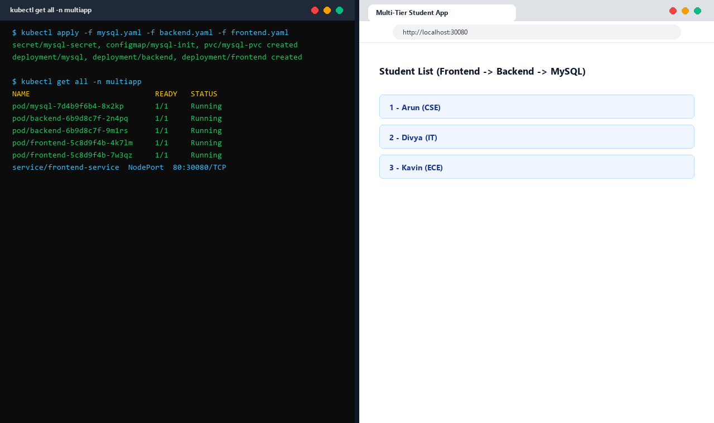
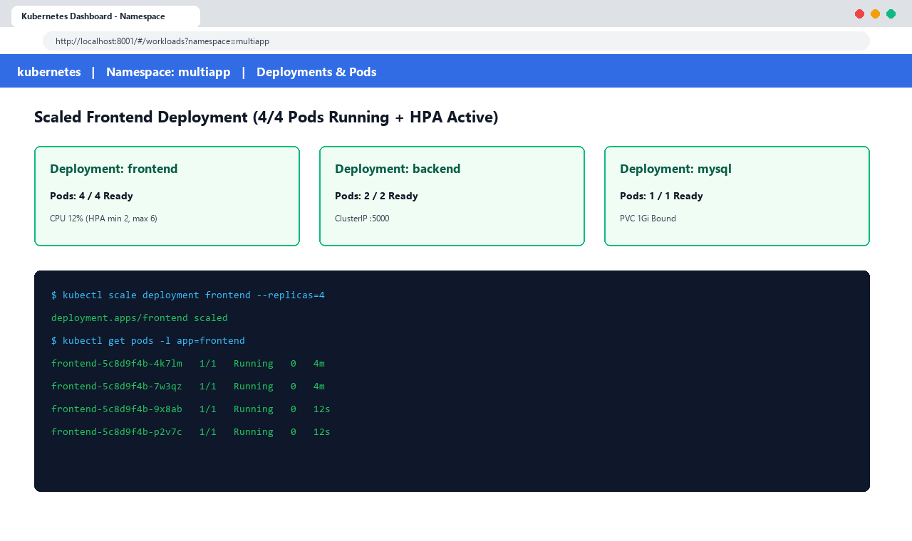

# Experiment 23: Multi-Container Application (Frontend, Backend, Database) on Kubernetes with Scaling

| Attribute | Details |
| :--- | :--- |
| **Experiment No.** | 23 |
| **Tools Used** | Docker, Kubernetes, `kubectl`, Minikube Dashboard |
| **Course Outcome** | CO3 |

---

## Problem Statement
Deploy a 3-tier multi-container application (**Nginx Frontend**, **Flask Backend**, **MySQL Database**) on Kubernetes using YAML manifests, monitor pods and services, and scale the frontend deployment to handle increased load.

## Aim
To deploy a multi-container 3-tier application on Kubernetes, monitor workloads, and scale the frontend tier.

## Deliverable Files
- Backend: [`backend/app.py`](./backend/app.py), [`backend/Dockerfile`](./backend/Dockerfile)
- Frontend: [`frontend/index.html`](./frontend/index.html), [`frontend/default.conf`](./frontend/default.conf), [`frontend/Dockerfile`](./frontend/Dockerfile)
- Kubernetes Manifests: [`mysql.yaml`](./mysql.yaml), [`backend.yaml`](./backend.yaml), [`frontend.yaml`](./frontend.yaml)

## Procedure & Commands
```bash
kubectl create namespace multiapp
kubectl config set-context --current --namespace=multiapp
kubectl apply -f mysql.yaml
kubectl apply -f backend.yaml
kubectl apply -f frontend.yaml
kubectl get all
kubectl scale deployment frontend --replicas=4
kubectl get pods -l app=frontend
kubectl autoscale deployment frontend --cpu-percent=50 --min=2 --max=6
```

## Output Screenshots

### 1. Cluster Deployment (`kubectl get all`) & Frontend Student List UI


### 2. Kubernetes Dashboard & Scaled Frontend (4 Replicas + HPA)


## Expected Output
- `mysql`, `backend`, and `frontend` pods Running; frontend displays student records fetched via backend from MySQL.
- Scaling increases frontend pods from 2 to 4 and updates Kubernetes Dashboard.

## Result
Thus a multi-container application with frontend, backend, and MySQL database was deployed on Kubernetes, monitored, and scaled successfully.

## Viva Voce Questions
1. **How do tiers locate each other?** Via Kubernetes Services and cluster DNS (e.g., `mysql-service:3306`).
2. **What is a Secret?** An object holding sensitive values like DB passwords encoded in base64.
3. **What is a PersistentVolumeClaim?** A storage claim preserving database data across pod restarts.
4. **Manual scaling vs HPA?** Manual scaling uses `kubectl scale`; HPA automatically scales pods based on CPU/metrics.
5. **Service type for MySQL?** `ClusterIP` so the database stays internal to the cluster.
