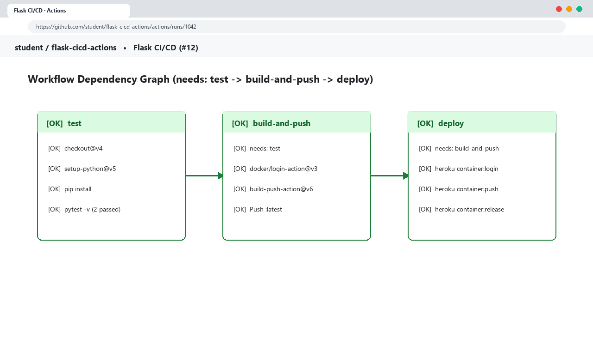
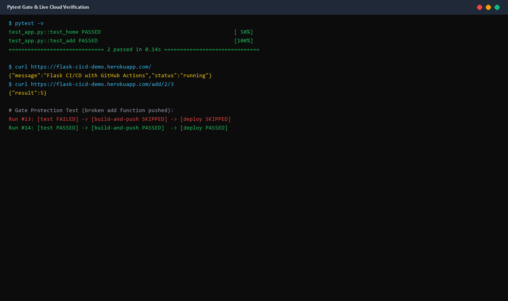

# Experiment 24: CI/CD Pipeline for a Flask Application using GitHub Actions with Cloud Deployment

| Attribute | Details |
| :--- | :--- |
| **Experiment No.** | 24 |
| **Tools Used** | GitHub Actions, Pytest, Docker, Heroku / AWS |
| **Course Outcome** | CO3 |

---

## Problem Statement
Create a complete CI/CD pipeline using GitHub Actions for a containerized Flask application (`test` → `build-and-push` → `deploy`) with unit tests (`pytest`), Docker Hub push, and automatic cloud deployment.

## Aim
To build a multi-stage CI/CD pipeline in GitHub Actions that runs automated tests, builds/pushes a Docker image, and deploys to the cloud.

## Deliverable Files
- [`app.py`](./app.py), [`test_app.py`](./test_app.py), [`requirements.txt`](./requirements.txt)
- [`Dockerfile`](./Dockerfile), [`.github/workflows/ci-cd.yml`](./.github/workflows/ci-cd.yml)

## Output Screenshots

### 1. GitHub Actions 3-Stage Pipeline (`test` → `build-and-push` → `deploy`)

### 2. Pytest Output, Live Cloud Endpoint & Failed-Test Gate Protection

## Expected Output
- All 3 jobs pass when `pytest` reports `2 passed`; failing tests block build and deploy jobs.
- Cloud endpoint returns `{"message": "Flask CI/CD with GitHub Actions", "status": "running"}` and `/add/2/3` returns `{"result": 5}`.

## Result
Thus a CI/CD pipeline was created with GitHub Actions to test, build, push, and deploy the Flask application automatically.

## Viva Voce Questions
1. **What does the `needs` keyword do?** Enforces job dependency so downstream jobs run only after upstream jobs succeed.
2. **Why run tests before building?** Prevents broken code from being packaged or deployed.
3. **How does Heroku specify the listening port?** Via the `PORT` environment variable.
4. **What is `pytest`?** A Python testing framework for unit and integration tests.
5. **What triggers this workflow?** Push or pull request events on the `main` branch.
