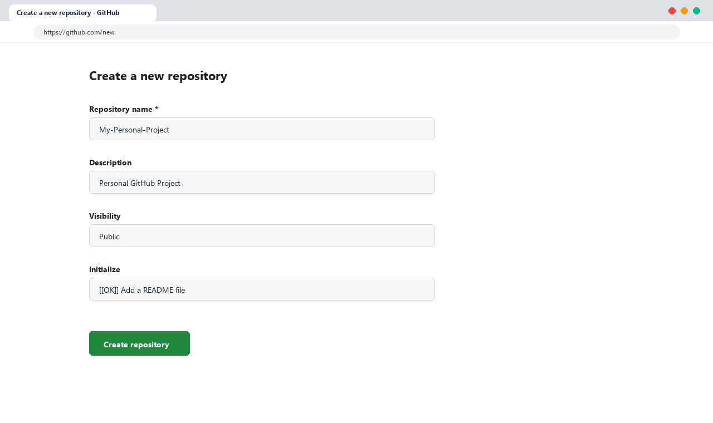
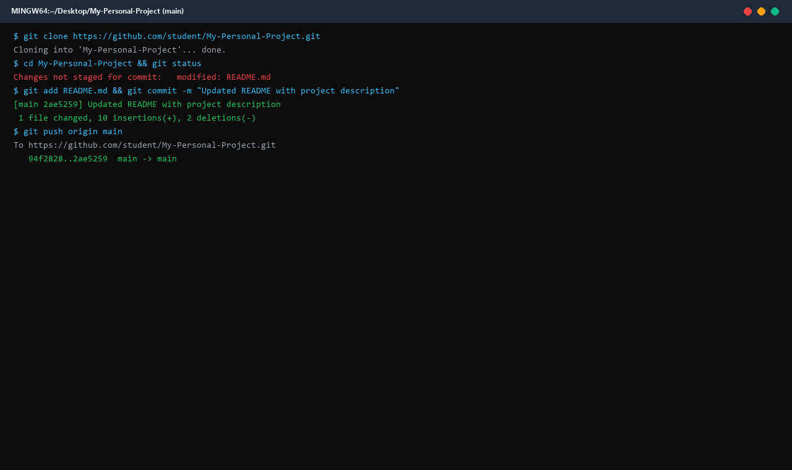

# Experiment 25: Creating a GitHub Repository and Pushing a README File

| Attribute | Details |
| :--- | :--- |
| **Experiment No.** | 25 |
| **Tools Used** | Git, GitHub, Visual Studio Code |
| **Course Outcome** | CO3 |

---

## Problem Statement
Create a new GitHub repository (`My-Personal-Project`), initialize it with `README.md`, clone it locally, add a project description, stage, commit, and push back to GitHub.

## Aim
To create a GitHub repository, clone it locally, update `README.md`, and push the commit to GitHub.

## Commands
```bash
git clone https://github.com/<username>/My-Personal-Project.git
cd My-Personal-Project
git status
git add README.md
git commit -m "Updated README with project description"
git push origin main
```
See [`commands.sh`](./commands.sh) and [`sample-README.md`](./sample-README.md).

## Output Screenshots

### 1. Create GitHub Repository & Clone Locally


### 2. Edit README, Stage, Commit, Push & GitHub Preview


## Expected Output
- `git commit` records 1 changed file; `git push origin main` updates GitHub and renders the updated README.

## Result
Thus a new GitHub repository was created, `README.md` was updated with the project description, and the changes were committed and pushed successfully.

## Viva Voce Questions
1. **What is the staging area?** Intermediate index preparing changes before `git commit`.
2. **What is `origin`?** Default remote name assigned by `git clone`.
3. **What is Markdown?** Lightweight plain-text formatting language used for READMEs.
4. **Difference between Git and GitHub?** Git is the distributed VCS tool; GitHub is a cloud hosting platform for Git repos.
5. **How to view commit history?** `git log` or `git log --oneline`.
