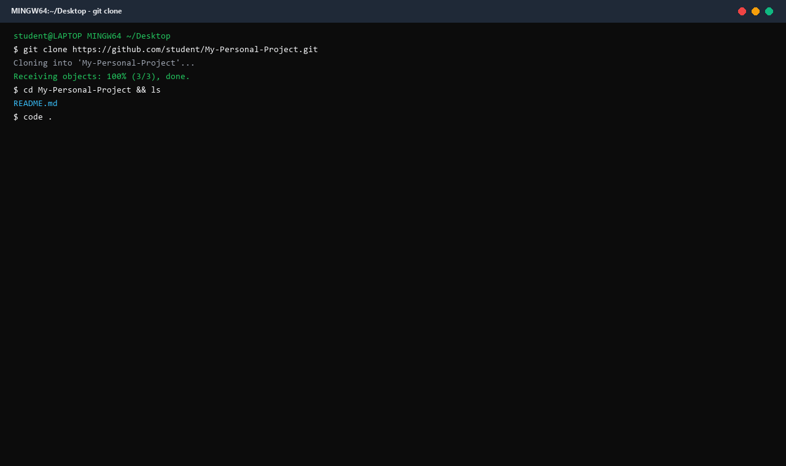
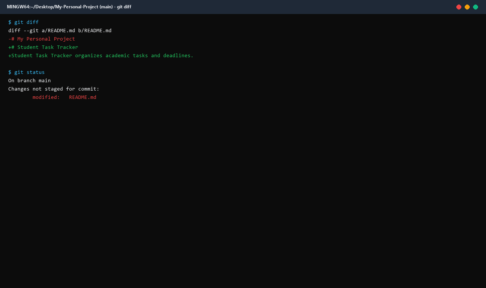

# Experiment 26: Cloning a GitHub Repository and Editing Files Locally

| Attribute | Details |
| :--- | :--- |
| **Experiment No.** | 26 |
| **Tools Used** | Git, GitHub, Visual Studio Code |
| **Course Outcome** | CO3 |

---

## Problem Statement
Clone an existing public GitHub repository locally using `git clone <repository_url>`, navigate into it, edit a file (`README.md`) in VS Code, and inspect changes with `git status` and `git diff`.

## Aim
To clone a GitHub repository locally and modify files cleanly.

## Commands
```bash
git clone https://github.com/<username>/My-Personal-Project.git
cd My-Personal-Project
code .
git diff
git status
```
See [`commands.sh`](./commands.sh).

## Output Screenshots

### 1. Copy HTTPS URL & `git clone` in Git Bash


### 2. Edit File in VS Code & Inspect `git diff` / `git status`


## Expected Output
- Repository cloned; `git diff` highlights added/deleted lines and `git status` shows `modified: README.md`.

## Result
Thus an existing GitHub repository was cloned to the local machine and a file was edited and verified locally.

## Viva Voce Questions
1. **What does `git clone` copy?** All tracked files, branches, and full commit history.
2. **What is `git remote -v`?** Lists fetch/push remote URLs.
3. **Which command shows exact modified lines?** `git diff`.
4. **HTTPS vs SSH cloning?** HTTPS authenticates via personal access token; SSH uses cryptographic key pairs.
5. **Can you clone a private repo?** Yes, with valid access permissions and authentication.
