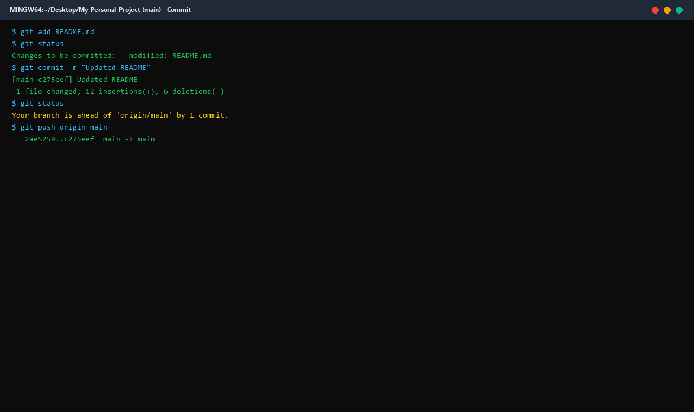
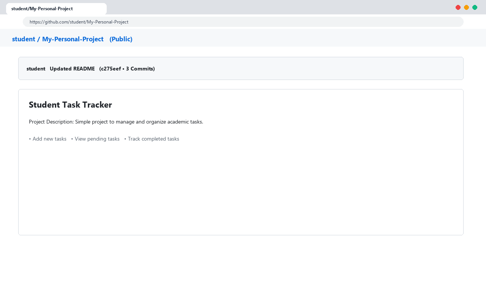

# Experiment 27: Committing and Pushing Changes to GitHub

| Attribute | Details |
| :--- | :--- |
| **Experiment No.** | 27 |
| **Tools Used** | Git, GitHub, Visual Studio Code |
| **Course Outcome** | CO4 |

---

## Problem Statement
After modifying a file in a cloned repository, stage the changes with `git add`, commit with `git commit -m "Updated README"`, and push to GitHub using `git push origin main`.

## Aim
To stage, commit, and push local repository changes to GitHub.

## Commands
```bash
git status
git add README.md
git commit -m "Updated README"
git status   # ahead of 'origin/main' by 1 commit
git push origin main
```
See [`commands.sh`](./commands.sh).

## Output Screenshots

### 1. Stage (`git add`) & Commit (`git commit`) in Git Bash


### 2. Push to Origin & Verify Updated GitHub History


## Expected Output
- Commit created locally, pushed to `origin/main`, and reflected in GitHub repository commit count and README preview.

## Result
Thus the local modifications were staged, committed, and pushed to GitHub successfully.

## Viva Voce Questions
1. **What is a commit?** A permanent snapshot of staged changes with author, timestamp, and message.
2. **How to edit the last commit message?** `git commit --amend -m "new message"` (prior to pushing).
3. **What does "ahead by 1 commit" mean?** One local commit has not yet been pushed to the remote.
4. **How to stage all modified files?** `git add .` or `git add -A`.
5. **What is `HEAD`?** A pointer to the current branch's latest commit.
