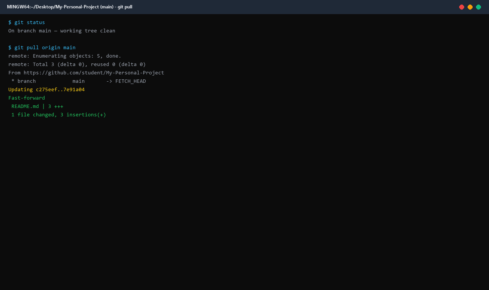
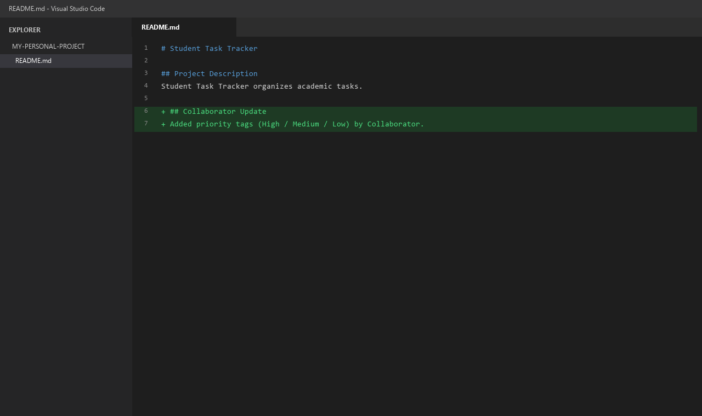

# Experiment 28: Pulling Collaborator Changes from GitHub

| Attribute | Details |
| :--- | :--- |
| **Experiment No.** | 28 |
| **Tools Used** | Git, GitHub, Visual Studio Code |
| **Course Outcome** | CO4 |

---

## Problem Statement
A collaborator pushes new commits to the shared repository. Use `git pull origin main` to fetch and merge their changes into your local repository and verify synchronization.

## Aim
To pull collaborator updates from GitHub and verify the local working tree stays synchronized.

## Commands
```bash
git status
git pull origin main
git log -n 2 --oneline
```
See [`commands.sh`](./commands.sh).

## Output Screenshots

### 1. `git pull origin main` Fast-Forward Output


### 2. Collaborator Changes Verified in VS Code & Clean Status


## Expected Output
- `git pull origin main` performs a fast-forward merge and updates local files.

## Result
Thus collaborator changes were pulled from GitHub and verified in the local repository.

## Viva Voce Questions
1. **Differentiate `git pull` and `git fetch`.** `fetch` downloads remote objects only; `pull` downloads and merges into the current branch.
2. **What is Fast-forward?** Advancing the local branch pointer directly when there are no divergent local commits.
3. **How to add a collaborator?** Settings → Collaborators → Add people.
4. **What if both edited the same line?** `git pull` reports a merge conflict for manual resolution.
5. **What is `git pull --rebase`?** Replays local commits atop newly fetched upstream commits without a merge commit.
