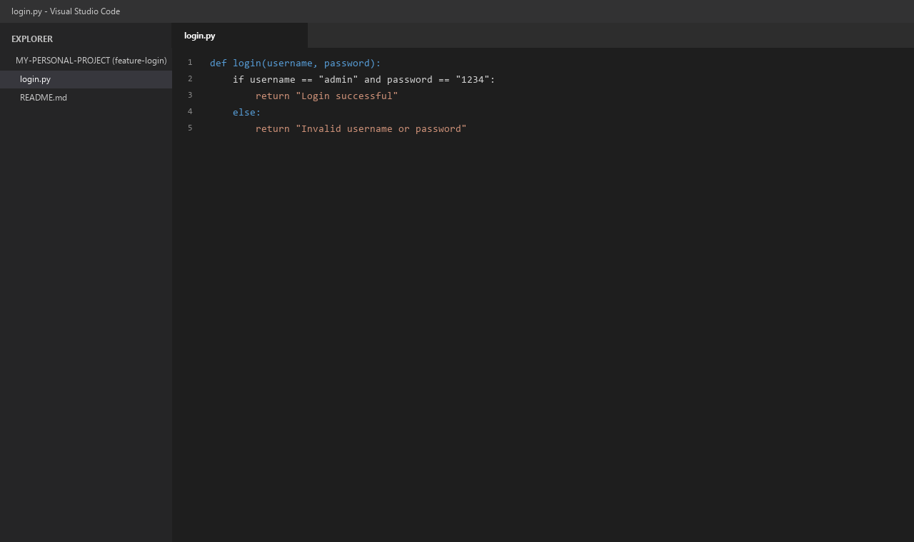
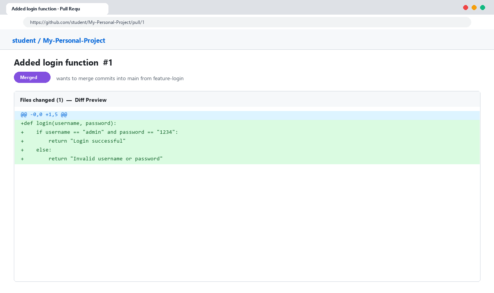

# Experiment 29: Feature Branch (`feature-login`) and Pull Request

| Attribute | Details |
| :--- | :--- |
| **Experiment No.** | 29 |
| **Tools Used** | Git, GitHub, Visual Studio Code, Python 3 |
| **Course Outcome** | CO4 |

---

## Problem Statement
Create a new branch named `feature-login`, implement a simple login function in `login.py`, commit and push the branch, create a Pull Request into `main`, merge it, and sync `main` locally.

## Aim
To develop a feature in an isolated branch (`feature-login`), open a Pull Request on GitHub, and merge it into `main`.

## Deliverable Files
- [`login.py`](./login.py)
- [`commands.sh`](./commands.sh)

## Output Screenshots

### 1. Create `feature-login` Branch & Implement `login.py`

### 2. Push Branch, Open/Merge Pull Request & Pull Updated `main`

## Expected Output
- `feature-login` pushed to GitHub; PR #1 merged cleanly into `main`; `git pull origin main` brings `login.py` into local `main`.

## Result
Thus the `feature-login` branch was created, `login.py` was implemented, pushed, and merged into `main` via a Pull Request.

## Viva Voce Questions
1. **What does `git checkout -b` do?** Creates a new branch and immediately switches to it.
2. **What does `-u` in `git push -u` do?** Configures upstream tracking for the branch.
3. **How to delete a merged local branch?** `git branch -d feature-login`.
4. **What is `git switch`?** Modern Git command for switching/creating branches (`git switch -c`).
5. **Why merge features through PRs?** Enables peer review and automated CI checks before code enters `main`.
