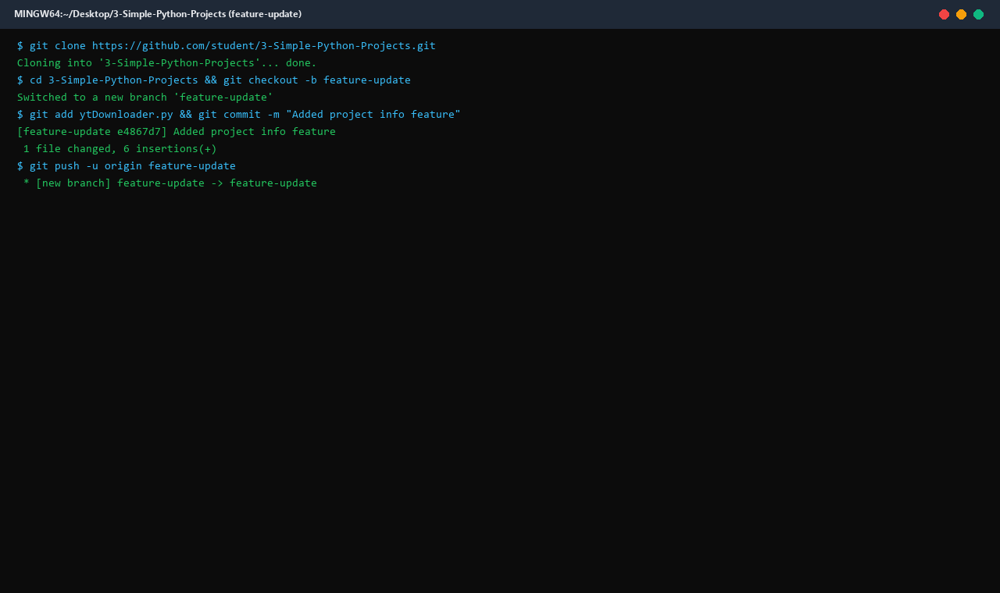
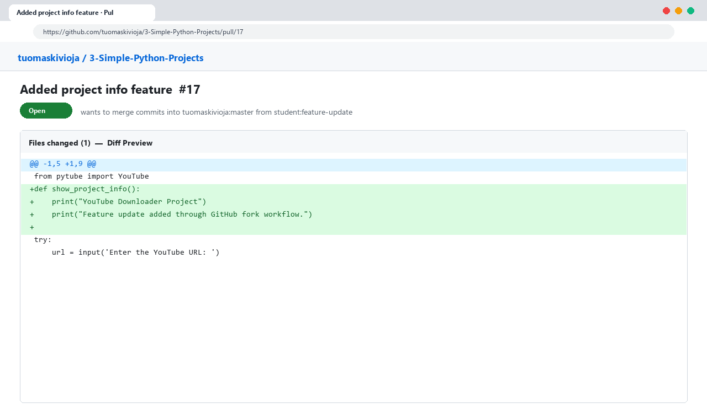

# Experiment 30: Forking, Feature Branch and Pull Request to the Original Repository

| Attribute | Details |
| :--- | :--- |
| **Experiment No.** | 30 |
| **Tools Used** | Git, GitHub, Visual Studio Code |
| **Course Outcome** | CO4 |

---

## Problem Statement
Fork a partner's or public repository (`3-Simple-Python-Projects`), clone the fork locally, create a feature branch (`feature-update`), add a new feature (`show_project_info()` in `ytDownloader.py`), commit, push to your fork, and submit a Pull Request to the original repository.

## Aim
To contribute safely to an external repository using fork, feature branch, push, and cross-repository Pull Request.

## Deliverable Files
- [`ytDownloader_feature.py`](./ytDownloader_feature.py)
- [`commands.sh`](./commands.sh)

## Output Screenshots

### 1. Fork Repository, Clone & Create `feature-update` Branch

### 2. Implement Feature, Push & Cross-Fork Pull Request Diff

## Expected Output
- Fork cloned, `feature-update` committed and pushed, and Pull Request opened from `<user>:feature-update` to `<upstream>:master` showing `+6` additions.

## Result
Thus the repository was forked and cloned, a feature was implemented on `feature-update`, pushed to the fork, and a Pull Request was submitted to the original repository.

## Viva Voce Questions
1. **What is `upstream`?** Conventionally refers to the original repository from which a fork was created.
2. **How do you keep a fork synchronized?** `git fetch upstream && git merge upstream/main` (or GitHub **Sync fork**).
3. **Can you push directly to the original repository?** Not without write access; contributions go through a Pull Request.
4. **Why develop on a feature branch inside the fork?** Keeps the fork's default branch clean and isolates the PR diff.
5. **What does the "Files changed" tab show?** A line-by-line diff of all additions and deletions in the PR.
